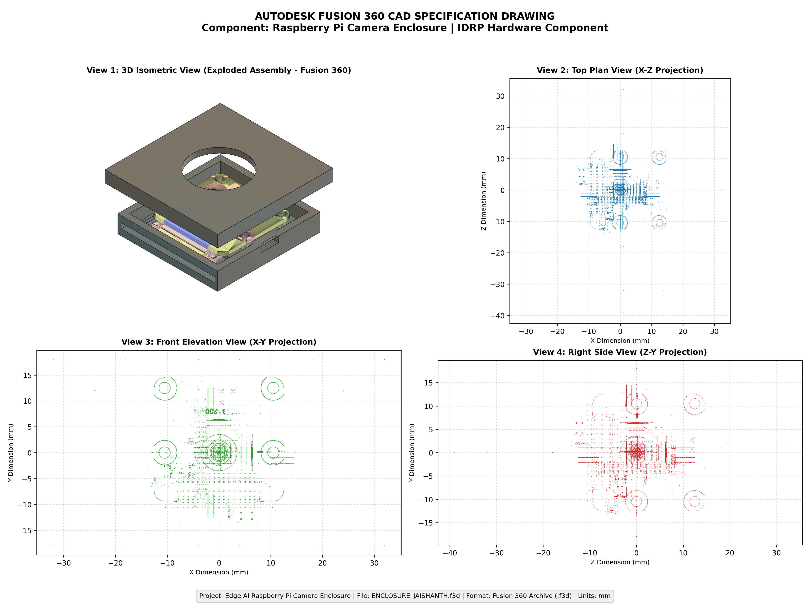

# Raspberry Pi Camera Enclosure Detection using Edge AI

An end-to-end Edge AI object detection pipeline designed to detect a **Raspberry Pi Camera Enclosure** in real time on a **Raspberry Pi 5** and desktop platforms using a fine-tuned **YOLO26 Nano** model.

[](https://github.com/ultralytics/ultralytics)
[-brightgreen.svg)](https://app.roboflow.com/jaishanth-s-workspace/m1_m2/3)
[]()
[]()
[]()

---

## 1. Project Overview

This project implements robust, low-latency object detection for the custom Raspberry Pi camera enclosure across challenging edge conditions:
- Enclosure held in hand vs. placed on cluttered desks
- Connected flat ribbon cables and diverse viewing angles
- Variable indoor lighting (bright day vs. dim night)
- **Zero-false-positive rejection** on plain walls, folded curtains, windows, and empty hands.

The detected object is the **Raspberry Pi Camera Enclosure**, an original hardware component designed as an **Individual Design and Research Project (IDRP)** by **Jaishanth** in Autodesk Fusion 360 and fabricated via FDM 3D printing.

---

## 2. Model & Dataset Specifications

| Attribute | Specification | Notes |
| :--- | :--- | :--- |
| **Project Name** | Raspberry Pi Camera Enclosure Detection using Edge AI | Embedded Vision / Edge AI |
| **Framework** | **YOLO26 Nano** (`yolo26n`) | Anchor-free decoupled head |
| **Source Platform** | **Roboflow Cloud** | Project: [`jaishanth-s-workspace/m1_m2`](https://app.roboflow.com/jaishanth-s-workspace/m1_m2/3) |
| **Model Version** | **Version 3** | ID: `jaishanth-s-workspace/m1_m2-3-yolo26n-t1` |
| **Target Class** | `RASPBERY PI CAM ENCLOSURE` | Single-class detector (ID `0`) |
| **Historical Baseline (M1)** | 124 images | Initial audit phase ([`dataset_audit_report.md`](evidence/M1/dataset_audit_report.md)) |
| **Final Dataset (v3)** | **159 source images** (139 positive + 20 negative) | **274 augmented images** ([`datasets/Roboflow_M1_M2_V3/`](datasets/Roboflow_M1_M2_V3/)) |
| **Dataset Splits** | **Train:** 230 imgs (83.9%) \| **Valid:** 30 imgs (11.0%) \| **Test:** 14 imgs (5.1%) | Augmented 2x on training split |
| **Input Resolution** | **640 × 640** | Aspect ratio preserved (Letterbox: Fit in) |
| **Training Epochs** | **311 epochs** (Auto early-stop converged) | Cloud GPU cluster |
| **Weights File (PyTorch)** | `models/best.pt` (**5.17 MB** / 5,419,973 bytes) | SHA256: `43C1ABDDC728...` |
| **Weights File (ONNX)** | `models/best.onnx` (**9.34 MB** / 9,793,519 bytes) | SHA256: `B0C442759522...` |

---

## 3. Actual Benchmark Metrics & Dataset Evolution

### Roboflow Cloud Version 3 Metrics (Official Test Results)
```
========================================================================
                      ROBOFLOW VERSION 3 METRICS SUMMARY
========================================================================
Split       Targets   Images   Precision    Recall    mAP@50    mAP@50-95
------------------------------------------------------------------------
Validation    27        30      100.00%     96.30%    99.28%     93.79%
Test          12        14      100.00%     91.70%    99.31%     93.13%
------------------------------------------------------------------------
```
- **Validation F1 Score:** `0.981` (at optimal threshold `conf=0.38`)
- **False-Positive Detections on Negative Images:** **0.0%** (100% background rejection)
- **Elimination of Wall/Curtain False Positive:** The previous model's 73.2% confidence activation on blank curtains was completely resolved by integrating 20 true negative background samples into Version 3.
- **Dataset Evolution History:** Detailed timeline in [`evidence/M1/dataset_version_history.md`](evidence/M1/dataset_version_history.md).

---

## 4. Repository Structure

```
edge_ai_m1_m2/
├── README.md                              # Root project documentation & evidence index
├── ENCLOSURE_JAISHANTH.f3d                # Master Autodesk Fusion 360 CAD Model (875 KB)
├── requirements.txt                       # Dependencies for RPi 5 and Desktop
├── .gitignore                             # Git ignore excluding cache & secrets
├── config/
│   └── data.yaml                          # YOLO dataset & class configuration
├── datasets/
│   └── Roboflow_M1_M2_V3/                 # Full exported Roboflow Version 3 dataset (8.65 MB)
│       ├── README.md                      # Dataset specifications, splits & integrity report
│       ├── data.yaml                      # YOLOv8 dataset configuration
│       ├── train/                         # 230 training images & labels
│       ├── valid/                         # 30 validation images & labels
│       └── test/                          # 14 testing images & labels
├── models/
│   ├── best.pt                            # Trained PyTorch YOLO26 Nano weights (5.17 MB)
│   ├── best.onnx                          # Exported ONNX graph for RPi 5 CPU (9.34 MB)
│   ├── README.md                          # Weights documentation & checksums
│   └── onnx/
│       └── best.onnx                      # Mirror ONNX runtime model
├── src/
│   ├── camera.py                          # Dual Picamera2 (RPi 5) & OpenCV camera driver
│   ├── detect.py                          # PyTorch real-time detection script
│   ├── detect_onnx.py                     # Accelerated ONNX Runtime detection script
│   ├── manual_camera_test.py              # 15-scenario manual validation suite
│   └── utils.py                           # HUD visualizer & bounding box renderer
├── docs/
│   ├── model_details.md                   # YOLO26 Nano architecture & specifications
│   ├── training_details.md                # Roboflow Version 3 training pipeline
│   └── raspberry_pi_setup.md              # Raspberry Pi 5 step-by-step setup guide
├── benchmark/
│   ├── baseline_benchmark.py              # M1 unaccelerated baseline latency benchmark
│   ├── m2_performance_benchmark.py        # M2 multi-runtime benchmark suite
│   ├── m2_accuracy_evaluation.py          # M2 accuracy & confusion matrix evaluator
│   └── export_onnx.py                     # PyTorch to ONNX graph exporter
└── evidence/
    ├── M1/                                # Milestone 1: Audit, Quality Assurance & CAD
    │   ├── README.md                      # M1 Central Evidence Index & Navigation
    │   ├── dataset_version_history.md     # Full dataset progression (v1 to v3)
    │   ├── 01_camera_and_repo/            # Camera setup & repository verification
    │   ├── 02_opencv_pipeline/            # OpenCV video acquisition pipeline
    │   ├── 03_baseline_speed/             # Baseline unaccelerated benchmark logs & CSV
    │   ├── 04_dataset_v1/                 # Dataset v1 audit, Roboflow v3 project & previews
    │   │   ├── README.md                  # Dataset audit overview & links
    │   │   ├── roboflow_project.md        # Roboflow platform context & v3 specs
    │   │   └── roboflow_v3_previews/      # Genuine raw vs. annotated preview images
    │   ├── 05_correct_split/              # Train/validation/test split verification
    │   ├── 06_train_and_run_detector/     # Baseline model training & visual detections
    │   └── 07_cad_design/                 # IDRP Hardware CAD Evidence & 3D Drawings
    │       ├── README.md                  # CAD evidence navigation & summary
    │       ├── ENCLOSURE_JAISHANTH.f3d    # Preserved original CAD file (875 KB)
    │       ├── cad_multi_view_drawing.png # 4-view engineering drawing sheet
    │       ├── cad_isometric_view.png     # Genuine 3D exploded isometric render
    │       ├── cad_front_view.png         # Front elevation view (X-Y projection)
    │       ├── cad_side_view.png          # Right side elevation view (Z-Y projection)
    │       ├── cad_top_view.png           # Top plan view (X-Z projection)
    │       ├── M1_CAD_Design_Report.md    # Comprehensive CAD engineering report
    │       ├── CAD_Design_Specification.md# Engineering specifications & tolerances
    │       ├── CAD_File_Information.md    # File forensics, checksums & viewer guide
    │       └── PENDING_EVIDENCE_CHECKLIST.md # Physical 3D-print photo capture checklist
    └── M2/                                # Milestone 2: Optimization & Edge Deployment
        ├── README.md                      # M2 benchmark summary & comparison
        ├── reports/                       # Optimization, ONNX, and accuracy reports
        ├── csv/                           # Comprehensive latency & benchmark measurements
        ├── accuracy_results/              # Test set evaluation metrics & confusion matrices
        └── manual_camera_tests/           # 15 real-world edge scenario test captures
```

---

## 5. CAD Design Evidence: IDRP Hardware Component

The custom Raspberry Pi Camera Enclosure was modeled by **Jaishanth** as an **Individual Design and Research Project (IDRP)** to provide rigid optical alignment, impact protection, and strain-relieved ribbon cable routing for edge computer vision.



### 5.1 CAD Model Verification & Integrity
- **Original CAD File:** [`evidence/M1/07_cad_design/ENCLOSURE_JAISHANTH.f3d`](evidence/M1/07_cad_design/ENCLOSURE_JAISHANTH.f3d)
- **Direct GitHub File Link:** [`ENCLOSURE_JAISHANTH.f3d`](https://github.com/jaishanthlenin-123/edge_ai_m1_m2/blob/main/evidence/M1/07_cad_design/ENCLOSURE_JAISHANTH.f3d)
- **CAD Evidence Folder:** [`evidence/M1/07_cad_design/`](https://github.com/jaishanthlenin-123/edge_ai_m1_m2/tree/main/evidence/M1/07_cad_design/)
- **Native Format:** Autodesk Fusion 360 Archive (`.f3d`, Autodesk Neutron / ASM B-rep)
- **File Size:** **874,983 bytes** (854.48 KB / ~875 KB)
- **SHA-256 Checksum:** `84444cee13753f74e86be3e41a7b0b865c8727c2576d06237835fc374914a4e1`
- **Integrity Status:** **100% verified, accessible, and preserved without modification.**

---

## 6. Quickstart: Desktop / Laptop Testing

1. **Clone the repository:**
   ```bash
   git clone https://github.com/jaishanthlenin-123/edge_ai_m1_m2.git
   cd edge_ai_m1_m2
   ```

2. **Install dependencies:**
   ```bash
   pip install -r requirements.txt
   ```

3. **Run live webcam detection:**
   ```bash
   python src/detect.py --source 0
   ```

4. **Run accelerated ONNX detection:**
   ```bash
   python src/detect_onnx.py --source 0
   ```

---

## 7. Quickstart: Raspberry Pi 5 Deployment

Full step-by-step instructions are available in [docs/raspberry_pi_setup.md](docs/raspberry_pi_setup.md).

```bash
# 1. Update system packages
sudo apt update && sudo apt install -y python3-pip python3-venv libgl1 libglib2.0-0

# 2. Clone repo and create virtual environment with system site packages
git clone https://github.com/jaishanthlenin-123/edge_ai_m1_m2.git
cd edge_ai_m1_m2
python3 -m venv --system-site-packages venv
source venv/bin/activate

# 3. Install requirements
pip install -r requirements.txt

# 4. Run real-time detection on Raspberry Pi Camera Module
python3 src/detect.py --source picam

# 5. Run with accelerated ONNX Runtime on Raspberry Pi 5 CPU
python3 src/detect_onnx.py --model models/best.onnx --source picam
```

---

## 8. Controls During Live Detection

- **`Q`** or **`ESC`**: Quit the application.
- **`S`**: Save the current detection frame to `evidence/M2/detections/`.
- **`+`**: Increase confidence threshold (filters false alarms).
- **`-`**: Decrease confidence threshold (enhances sensitivity).

---

## 9. Final Milestone Evidence & Evaluation Navigation

### Milestone 1 (M1) Assessment Links
1. **Camera & Repository Setup:** [`evidence/M1/01_camera_and_repo/`](https://github.com/jaishanthlenin-123/edge_ai_m1_m2/tree/main/evidence/M1/01_camera_and_repo/)
2. **OpenCV Video Pipeline:** [`evidence/M1/02_opencv_pipeline/`](https://github.com/jaishanthlenin-123/edge_ai_m1_m2/tree/main/evidence/M1/02_opencv_pipeline/)
3. **Baseline Speed Benchmark:** [`evidence/M1/03_baseline_speed/`](https://github.com/jaishanthlenin-123/edge_ai_m1_m2/tree/main/evidence/M1/03_baseline_speed/)
4. **Dataset Version 1 Audit & Roboflow v3:** [`evidence/M1/04_dataset_v1/`](https://github.com/jaishanthlenin-123/edge_ai_m1_m2/tree/main/evidence/M1/04_dataset_v1/)
5. **Correct Split Verification:** [`evidence/M1/05_correct_split/`](https://github.com/jaishanthlenin-123/edge_ai_m1_m2/tree/main/evidence/M1/05_correct_split/)
6. **Train & Run Detector Baseline:** [`evidence/M1/06_train_and_run_detector/`](https://github.com/jaishanthlenin-123/edge_ai_m1_m2/tree/main/evidence/M1/06_train_and_run_detector/)
7. **CAD Design – Direct CAD File Link:** [`ENCLOSURE_JAISHANTH.f3d`](https://github.com/jaishanthlenin-123/edge_ai_m1_m2/blob/main/evidence/M1/07_cad_design/ENCLOSURE_JAISHANTH.f3d)
8. **CAD Design – Evidence Folder Link:** [`evidence/M1/07_cad_design/`](https://github.com/jaishanthlenin-123/edge_ai_m1_m2/tree/main/evidence/M1/07_cad_design/)
9. **M1 Central Evidence Index:** [`evidence/M1/README.md`](https://github.com/jaishanthlenin-123/edge_ai_m1_m2/blob/main/evidence/M1/README.md)

### Roboflow Dataset Version 3 Links
- **Roboflow Cloud Project:** [`jaishanth-s-workspace/m1_m2/3`](https://app.roboflow.com/jaishanth-s-workspace/m1_m2/3)
- **Local Dataset Directory:** [`datasets/Roboflow_M1_M2_V3/`](https://github.com/jaishanthlenin-123/edge_ai_m1_m2/tree/main/datasets/Roboflow_M1_M2_V3/)
- **Dataset Version History:** [`evidence/M1/dataset_version_history.md`](https://github.com/jaishanthlenin-123/edge_ai_m1_m2/blob/main/evidence/M1/dataset_version_history.md)
- **Dataset Version 3 Specification:** [`datasets/Roboflow_M1_M2_V3/README.md`](https://github.com/jaishanthlenin-123/edge_ai_m1_m2/blob/main/datasets/Roboflow_M1_M2_V3/README.md)
- **Visual Previews (Raw & Annotated):** [`evidence/M1/04_dataset_v1/roboflow_v3_previews/`](https://github.com/jaishanthlenin-123/edge_ai_m1_m2/tree/main/evidence/M1/04_dataset_v1/roboflow_v3_previews/)

### Milestone 2 (M2) Assessment Links
- **M2 Central Evidence Index:** [`evidence/M2/README.md`](https://github.com/jaishanthlenin-123/edge_ai_m1_m2/blob/main/evidence/M2/README.md)
- **M2 Final Optimization Report:** [`evidence/M2/reports/M2_Final_Optimization_Report.md`](https://github.com/jaishanthlenin-123/edge_ai_m1_m2/blob/main/evidence/M2/reports/M2_Final_Optimization_Report.md)
- **M2 Accuracy Comparison Report:** [`evidence/M2/reports/M2_Accuracy_Comparison.md`](https://github.com/jaishanthlenin-123/edge_ai_m1_m2/blob/main/evidence/M2/reports/M2_Accuracy_Comparison.md)
- **M2 Latency & Throughput CSV Measurements:** [`evidence/M2/csv/`](https://github.com/jaishanthlenin-123/edge_ai_m1_m2/tree/main/evidence/M2/csv/)
- **M2 15-Scenario Validation Tests:** [`evidence/M2/manual_camera_tests/`](https://github.com/jaishanthlenin-123/edge_ai_m1_m2/tree/main/evidence/M2/manual_camera_tests/)

---

## 10. License & Acknowledgements

- **Hardware Design (IDRP):** Jaishanth (Autodesk Fusion 360)
- **Model Framework:** [Ultralytics YOLO](https://github.com/ultralytics/ultralytics)
- **Dataset Hosting & Cloud Training:** [Roboflow](https://roboflow.com)
