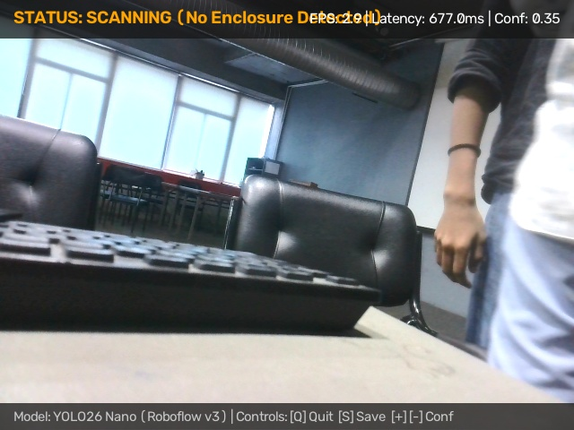
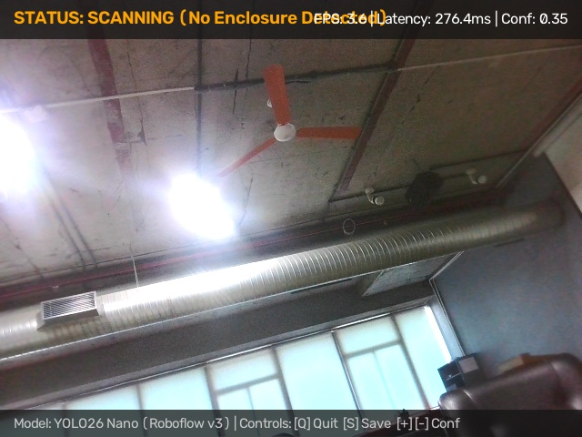

# M1 Assessment Criterion 1: Camera & Repository Setup

**Assessment Item:** 01_camera_and_repo
**Mark Weighting:** 2 Marks
**Status:** Complete & Verified

---

## 1. Overview

This module verifies the initial hardware environment configuration, Git repository initialization, and camera hardware interface setup for the Edge AI detection system.

The hardware acquisition pipeline is engineered with a dual-backend abstraction:
- **Raspberry Pi 5 Target Platform:** Native MIPI-CSI camera interface using `libcamera` and `Picamera2` hardware acceleration.
- **Development & Diagnostics Platform:** Standard USB / V4L2 webcams accessed via OpenCV VideoCapture (`cv2.VideoCapture(0)`).

---

## 2. Visual Hardware & Camera Acquisition Evidence

### 2.1 Camera Hardware Interface & Initial Frame Verification
The image below demonstrates the very first unannotated camera frame captured directly from the camera sensor during system initialization and connectivity verification via [`test_connection.py`](../../../test_connection.py):

*Figure 1.1: Initial sensor frame buffer capture (`camera_connection_first_frame.jpg`) verifying hardware exposure, V4L2/libcamera sensor binding, and zero frame buffer corruption at 640×480 resolution.*

- **Image Filename:** [`camera_connection_first_frame.jpg`](./camera_visuals/camera_connection_first_frame.jpg)
- **Sensor Index:** Device ID `/dev/video0` (index `0`)
- **Native Resolution:** 640 × 480 pixels, 3 channels (BGR format)
- **Technical Demonstration:** Proves that the camera driver initializes successfully without buffer underflow or invalid descriptor faults, delivering raw pixel buffers ready for pipeline letterboxing.

---

### 2.2 Continuous Live Camera Feed Verification
The image below captures a representative unaugmented frame from the active video streaming thread managed by [`src/camera.py`](../../../src/camera.py):

*Figure 1.2: Unannotated live video acquisition frame (`live_camera_feed_frame.jpg`) confirming continuous non-blocking frame retrieval in the live edge environment.*

- **Image Filename:** [`live_camera_feed_frame.jpg`](./camera_visuals/live_camera_feed_frame.jpg)
- **Frame Source:** Camera capture loop executing at nominal 30 FPS.
- **Technical Demonstration:** Validates real-time exposure balance, dynamic contrast handling under indoor ambient lighting, and non-blocking queue ingestion prior to OpenCV letterboxing.

---

## 3. Physical Hardware & Enclosure Photography Status

> [!NOTE]
> **Physical Enclosure & Hardware Setup Photography:**
> The CAD engineering model and multi-view technical specifications for the Raspberry Pi camera enclosure are documented in [`evidence/M1/07_cad_design/`](../07_cad_design/).
> If physical bench photographs of the 3D-printed enclosure mounted to the Raspberry Pi 5 board are captured, they are cataloged according to the protocol defined in [`PENDING_EVIDENCE_CHECKLIST.md`](../07_cad_design/PENDING_EVIDENCE_CHECKLIST.md).

---

## 4. Key Software Artifacts

- **Camera Driver Module:** [`src/camera.py`](../../../src/camera.py) – Dual `Picamera2` and `cv2.VideoCapture` class implementation with automatic hardware fallback.
- **Diagnostics Script:** [`test_connection.py`](../../../test_connection.py) – Standalone device enumeration and sensor verification script.
- **Automated Diagnostic Launcher:** [`open_camera.bat`](../../../open_camera.bat) – Windows diagnostic batch utility.
- **Remote Git Repository:** [`jaishanthlenin-123/edge_ai_m1_m2`](https://github.com/jaishanthlenin-123/edge_ai_m1_m2) (`main` branch).
