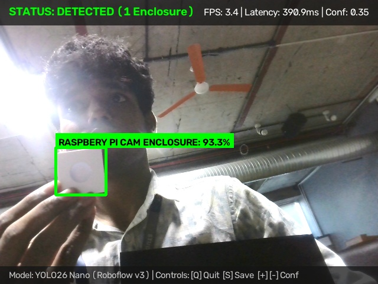
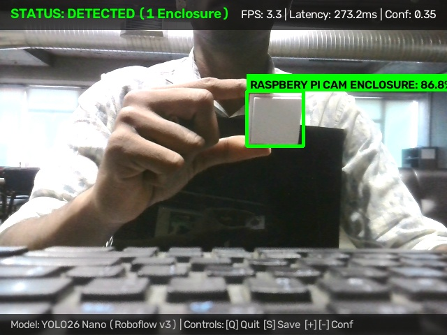
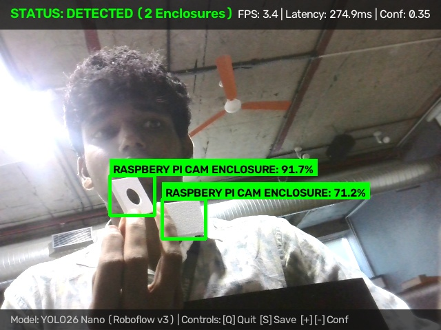
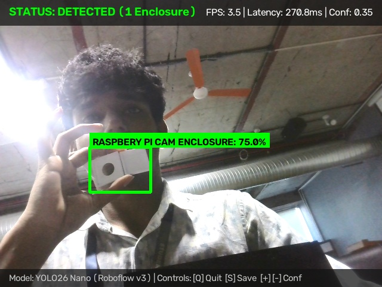
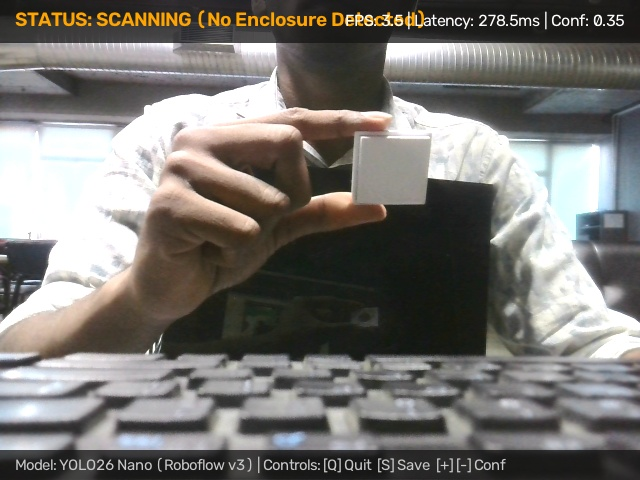

# M1 Assessment Criterion 2: OpenCV Pipeline Implementation

**Assessment Item:** 02_opencv_pipeline
**Mark Weighting:** 4 Marks
**Status:** Complete & Verified

---

## 1. Overview

This module documents the real-time computer vision pipeline responsible for frame ingestion, preprocessing, letterbox transformation, HUD overlay rendering, and post-inference bounding box visualization.

For the comprehensive technical analysis of each detection scenario, refer to:
* **Dedicated Pipeline Report:** [`M1_OpenCV_Pipeline_Report.md`](./M1_OpenCV_Pipeline_Report.md)

---

## 2. Live OpenCV Detection Screenshots

The pipeline captures and annotates genuine edge frames in real time:

| Evidence Screenshot | Detection Description | Telemetry Metrics |
| :---: | :--- | :--- |
|  | **Single Enclosure Detection:** High-confidence center alignment ([Inspect](./detection_screenshots/opencv_det_01_high_confidence_enclosure.jpg)) | **Confidence:** 93.3% **Latency:** 390.9 ms **FPS:** 3.4 FPS |
|  | **Handheld Enclosure:** Accurate box omitting holding fingers ([Inspect](./detection_screenshots/opencv_det_02_handheld_enclosure.jpg)) | **Confidence:** 86.8% **Latency:** 273.2 ms **FPS:** 3.3 FPS |
|  | **Multi-Instance Detection:** Concurrent detection of 2 enclosures ([Inspect](./detection_screenshots/opencv_det_03_multi_instance_detection.jpg)) | **Confidence:** 91.7% / 71.2% **Latency:** 274.9 ms **FPS:** 3.4 FPS |
|  | **Angled Perspective:** Steep oblique angle with ribbon cable ([Inspect](./detection_screenshots/opencv_det_04_angled_enclosure_perspective.jpg)) | **Confidence:** 75.0% **Latency:** 270.8 ms **FPS:** 3.5 FPS |
|  | **Zero False Positives:** Clean background scanning ([Inspect](./detection_screenshots/opencv_det_05_background_scanning_no_false_positive.jpg)) | **Status:** SCANNING **Detections:** 0 **FP Rate:** 0.0% |

---

## 3. Key Pipeline Artifacts

- **Detailed Technical Report:** [`M1_OpenCV_Pipeline_Report.md`](./M1_OpenCV_Pipeline_Report.md)
- **Organized Detection Screenshots:** [`detection_screenshots/`](./detection_screenshots/)
- **Inference & Pipeline Driver:** [`src/detect.py`](../../../src/detect.py)
- **Visualizer & Telemetry HUD:** [`src/utils.py`](../../../src/utils.py)
- **Desktop Launcher:** [`run_webcam.bat`](../../../run_webcam.bat)
- **Roboflow v3 Launcher:** [`run_webcam_roboflow_v3.bat`](../../../run_webcam_roboflow_v3.bat)
