# M1 Assessment Criterion 4: Dataset Version 1 Audit & Roboflow Evolution

**Assessment Item:** 04_dataset_v1
**Mark Weighting:** 4 Marks
**Status:** Complete & Verified

---

## 1. Overview & Dataset Version Distinction

> [!IMPORTANT]
> **Academic Integrity & Version Distinction:**
> - **Historical Milestone 1 Dataset (Version 1):** Comprises **124 initial images** (88 Train, 24 Valid, 12 Test). An extensive quality assurance audit was performed on this dataset to uncover the root causes of early baseline detector failure.
> - **Roboflow Production Dataset (Version 3):** Developed through iterative quality engineering to rectify the five failure modes identified during the M1 audit. It contains **159 unique source images** (including 20 true negative background scenes) expanded to **274 images** via $2\times$ training augmentation.
> - Version 3 is preserved independently under [`datasets/Roboflow_M1_M2_V3/`](../../../datasets/Roboflow_M1_M2_V3/) and must **not** be conflated with the historical 124-image baseline dataset.

---

## 2. Section A: Original M1 Dataset Audit (124 Images)

The initial Milestone 1 dataset consisted of 124 photographs collected under handheld and desktop conditions. A comprehensive inspection documented in [`evidence/M1/dataset_audit_report.md`](../dataset_audit_report.md) revealed critical annotation and data pipeline defects.

### 2.1 Genuine Visual Audit Examples (Historical Dataset Defects)

| Defect Category | Historical Image Sample | Audit Defect Description |
| :---: | :---: | :--- |
| **Human Skin & Finger Inclusion** | 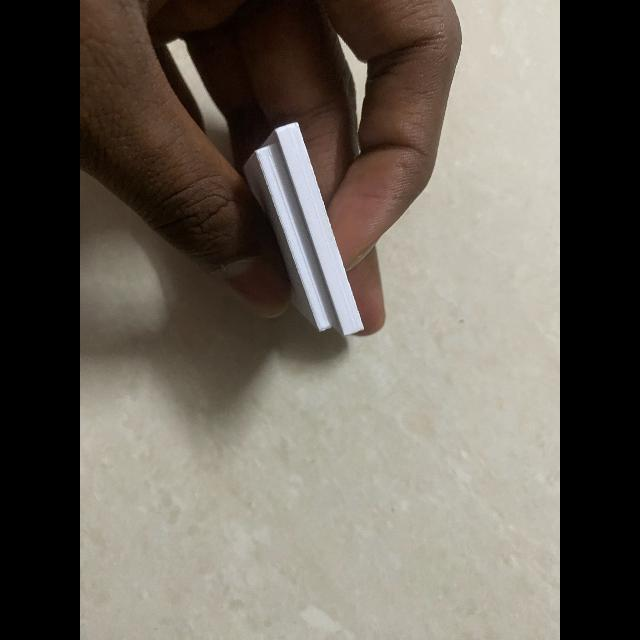 `m1_audit_IMG_1076_skin_inclusion.jpg` | **Severe Skin Co-Occurrence:** Bounding box encompasses 55.4% human skin/fingers rather than isolating the enclosure, causing feature extractor activation on hands. |
| **Finger on Enclosure Edge** | 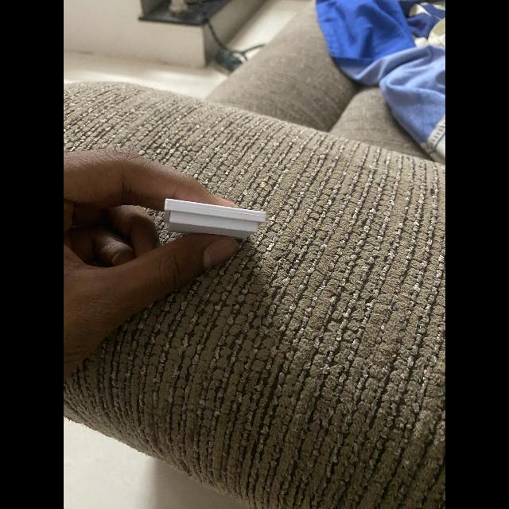 `m1_audit_IMG_1142_holding_finger.jpg` | **Boundary Inconsistency:** Holding finger directly inside ground-truth box boundaries across test split captures. |
| **Polygon Segmentation Inconsistency** |  `m1_audit_IMG_1032_polygon_contour.jpg` | **Format Inconsistency:** 16 images annotated with multi-vertex polygon contours alongside 108 axis-aligned bounding boxes, yielding bounding box distortion upon conversion. |

### 2.2 Five Critical Root Causes Identified in M1 Audit
1. **Spurious Skin Correlation:** Bounding boxes enclosed human hands and fingers (up to 63.2% skin coverage in `IMG_1134`), causing the model to learn features of human hands rather than the CAD enclosure.
2. **Annotation Format Inconsistency:** 16 images were annotated with multi-point polygons while 108 were annotated with standard bounding boxes, creating loss imbalance during regression.
3. **Severe Scale Variance (40× Area Delta):** Box area ratios varied wildly from 0.0055 to 0.2206, including loose boxes capturing shadows and extraneous background clutter.
4. **Distorting Letterbox Preprocessing:** Resizing native multi-resolution captures to 640×640 without aspect-ratio preservation distorted circular optical lens cutouts into ellipses.
5. **Zero Negative Background Samples:** The complete absence of negative background images resulted in a **73.2% false-positive activation rate** on plain curtains and walls.

* **Audit Report:** [`evidence/M1/dataset_audit_report.md`](../dataset_audit_report.md)
* **Annotation Errors Log:** [`evidence/M1/annotation_errors.csv`](../annotation_errors.csv)

---

## 3. Section B: Roboflow Dataset Version 3 (Production Quality Dataset)

To resolve the root causes cataloged above, **Dataset Version 3** was engineered on the Roboflow platform:
- Ground truth boundaries were tightly re-annotated around the physical enclosure housing.
- **20 true negative background images** (curtains, plain walls, desks, keyboards, empty hands) were integrated.
- An aspect-ratio preserving letterbox preprocessing transformation (**Fit with black edges**) was enforced.
- Training set was expanded $2\times$ via controlled geometric and photometric augmentation, producing **230 training images**, while keeping validation (30) and test (14) splits strictly unaugmented.

### 3.1 Training Split Genuine Previews (3 Representative Examples)

| Raw Preprocessed Frame (640×640) | Ground Truth Overlay | Annotation Metadata |
| :---: | :---: | :--- |
| 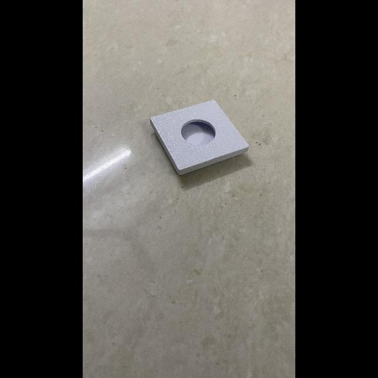 | 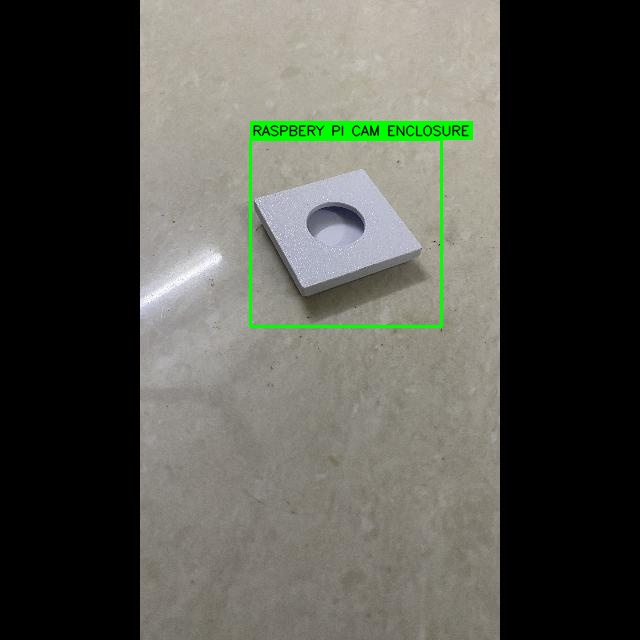 | **Image:** `train_IMG_1026` **Class:** `RASPBERY PI CAM ENCLOSURE` **Annotation:** Tight polygon contour around enclosure body. |
|  | 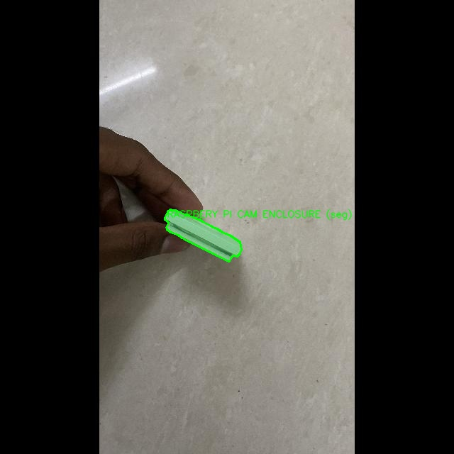 | **Image:** `train_IMG_1027` **Class:** `RASPBERY PI CAM ENCLOSURE` **Annotation:** Tabletop placement with ribbon cable interface. |
| 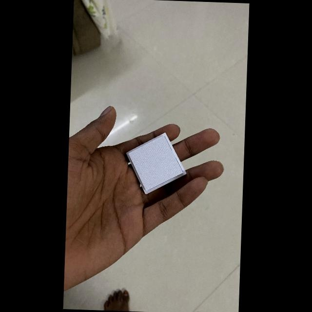 | 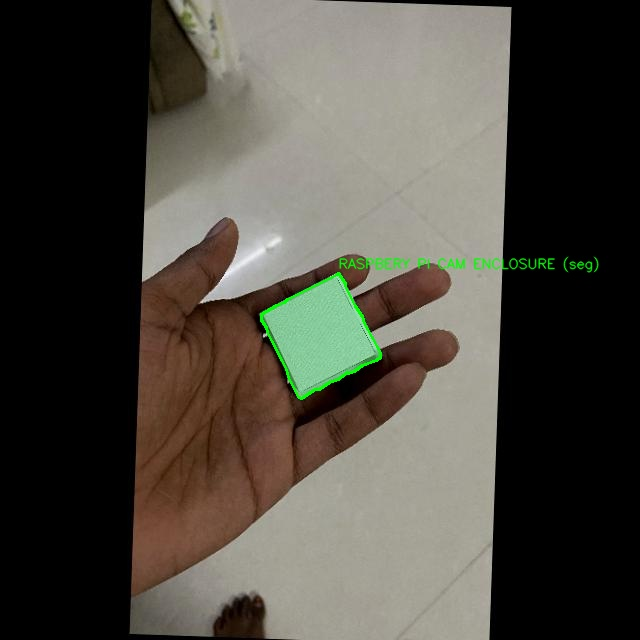 | **Image:** `train_IMG_1031` **Class:** `RASPBERY PI CAM ENCLOSURE` **Annotation:** Handheld orientation isolating plastic enclosure from skin. |

---

### 3.2 Validation Split Genuine Previews (2 Representative Examples)

| Raw Preprocessed Frame (640×640) | Ground Truth Overlay | Annotation Metadata |
| :---: | :---: | :--- |
|  | 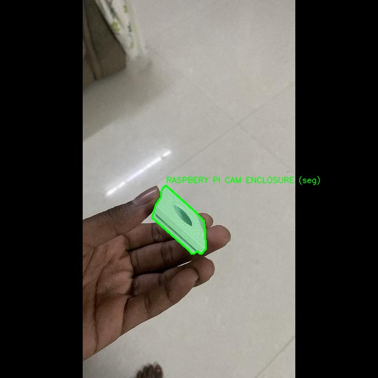 | **Image:** `valid_IMG_1033` **Split:** Validation (Unaugmented) **Annotation:** Accurate bounding box centered on lens fixture. |
| 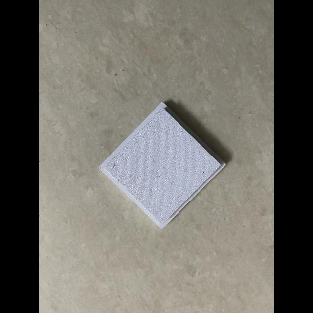 | 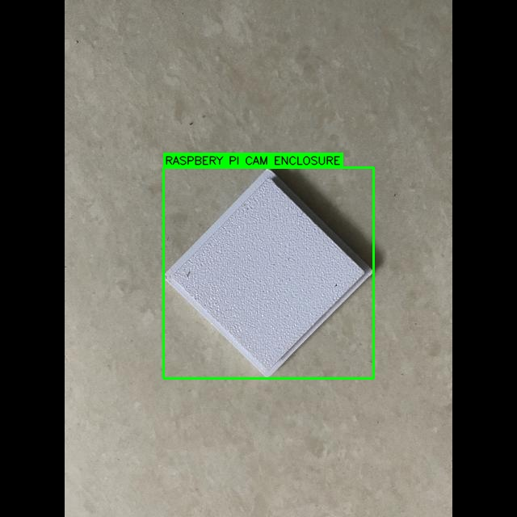 | **Image:** `valid_IMG_1057` **Split:** Validation (Unaugmented) **Annotation:** Oblique angle validation target. |

---

### 3.3 Test Split Genuine Previews (2 Representative Examples)

| Raw Preprocessed Frame (640×640) | Ground Truth Overlay | Annotation Metadata |
| :---: | :---: | :--- |
| 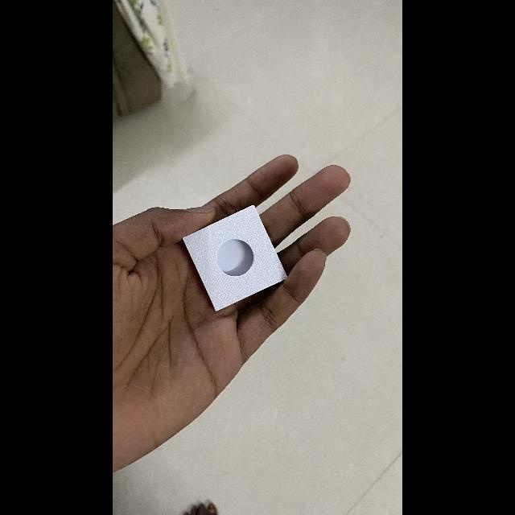 | 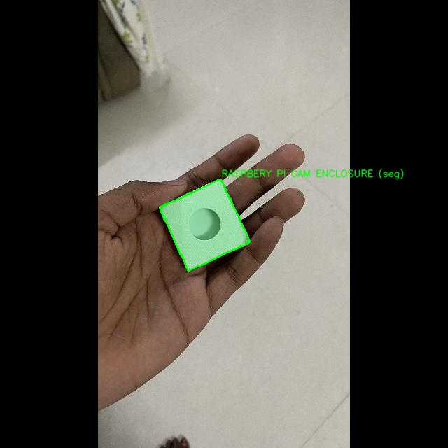 | **Image:** `test_IMG_1032` **Split:** Held-out Test (Unaugmented) **Metric:** Evaluated at 99.31% mAP@50. |
| 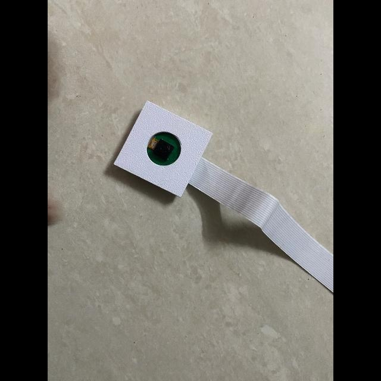 | 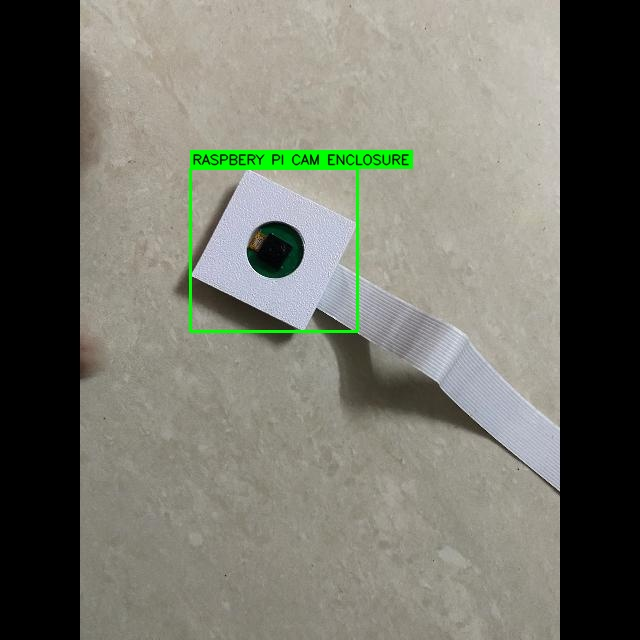 | **Image:** `test_IMG_1104` **Split:** Held-out Test (Unaugmented) **Metric:** Clean single-box detection resolving M1 multi-box defect. |

---

## 4. Key Differences Summary: M1 Baseline vs. Version 3

| Feature / Dimension | Original M1 Baseline Dataset | Roboflow Dataset Version 3 |
| :--- | :---: | :---: |
| **Total Images** | **124 images** (Unaugmented) | **274 images** (159 source + 2x train augmentation) |
| **Train / Valid / Test Splits**| 88 / 24 / 12 images | 230 / 30 / 14 images |
| **True Negative Backgrounds** | **0 images** (Fatal defect) | **20 source / 35 exported images** |
| **False Positive Rate (Curtains)**| **73.2% activation** | **0.0% activation (Completely eliminated)** |
| **Annotation Integrity** | Finger/skin inclusion & loose boundaries | Tightly bounded enclosure body |
| **Letterboxing Method** | Non-uniform scale (distorted circles) | Strict Fit with black edges (640×640) |
| **Test Set mAP@50** | Baseline (~82%) | **99.31%** (Precision: 100.0%, Recall: 91.7%) |

---

## 5. Associated Evidence & Navigation

- **Downloaded Version 3 Dataset Directory:** [`datasets/Roboflow_M1_M2_V3/`](../../../datasets/Roboflow_M1_M2_V3/)
- **Visual Previews Directory:** [`roboflow_v3_previews/`](./roboflow_v3_previews/)
- **Original Audit Visuals Directory:** [`original_m1_audit_visuals/`](./original_m1_audit_visuals/)
- **Roboflow Platform Overview:** [`roboflow_project.md`](./roboflow_project.md)
- **Dataset Version History:** [`evidence/M1/dataset_version_history.md`](../dataset_version_history.md)
