# Milestone 1 (M1) Technical Report: Dataset Split Verification

**Assessment Item:** 05_correct_split
**Mark Weighting:** 2 Marks
**Author:** Jaishanth
**Date:** November 2026
**Status:** Complete & Statistically Verified

---

## 1. Executive Summary

This report documents the statistical distribution, domain isolation, and absence of data leakage across the training, validation, and test splits used to train and evaluate the YOLO26 Nano edge vision detector.

To maintain strict scientific and operational integrity:
1. **Zero Data Leakage:** Image content hashes verify that zero images or frames overlap between the training, validation, and testing partitions.
2. **Strict Isolation of Evaluation Sets:** The validation (30 images) and test (14 images) sets were kept strictly unaugmented, providing an unbiased ground truth benchmark for generalization.
3. **True Negative Representation:** Background images (walls, curtains, empty hands) are proportionally distributed across all three splits.

---

## 2. Dataset Split Statistics & Distribution

| Split Stage | Source Images | Augmented Exported Images | Split % | Ground Truth Targets | True Negatives (Empty Labels) |
| :--- | :---: | :---: | :---: | :---: | :---: |
| **Training Set** | 115 images | **230 images** | 83.94% | 200 (176 bboxes + 24 polygons) | **30 images** |
| **Validation Set** | 30 images | **30 images** | 10.95% | 27 (24 bboxes + 3 polygons) | **3 images** |
| **Testing Set** | 14 images | **14 images** | 5.11% | 12 (11 bboxes + 1 polygon) | **2 images** |
| **Total** | **159 images** | **274 images** | **100.0%** | **239 targets** | **35 images** |

*Note on Augmentation:* The original 115 training source captures underwent a $2\times$ augmentation pipeline (horizontal flip, $\pm 10^\circ$ rotation, $\pm 15\%$ brightness, $\pm 15\%$ saturation), yielding 230 training images. Validation and test sets were preserved strictly without augmentation.

---

## 3. Data Leakage Verification Results

A complete programmatic MD5 and SHA-256 hash collision audit was executed across all 274 image files in the dataset:

| Verification Stage | Check Performed | Collision Count | Status |
| :--- | :--- | :---: | :---: |
| **Train $\leftrightarrow$ Valid** | Cross-split SHA-256 hash collision check | **0** | **PASS (Zero Leakage)** |
| **Train $\leftrightarrow$ Test** | Cross-split SHA-256 hash collision check | **0** | **PASS (Zero Leakage)** |
| **Valid $\leftrightarrow$ Test** | Cross-split SHA-256 hash collision check | **0** | **PASS (Zero Leakage)** |
| **Intra-Split Train** | Duplicate detection within training split | **0** | **PASS (Unique Samples)** |
| **Intra-Split Valid** | Duplicate detection within validation split | **0** | **PASS (Unique Samples)** |
| **Intra-Split Test** | Duplicate detection within test split | **0** | **PASS (Unique Samples)** |

---

## 4. Visual Evidence of Dataset Splits

All sample images below are extracted directly from their respective split directories under [`datasets/Roboflow_M1_M2_V3/`](../../../datasets/Roboflow_M1_M2_V3/).

---

### 4.1 Training Set Visual Samples

Representative samples from [`datasets/Roboflow_M1_M2_V3/train/images/`](../../../datasets/Roboflow_M1_M2_V3/train/images/):

| Sample ID | Raw Exported Image (640×640) | Ground Truth Overlay | Annotation Breakdown |
| :---: | :---: | :---: | :--- |
| **Train Sample 01** | 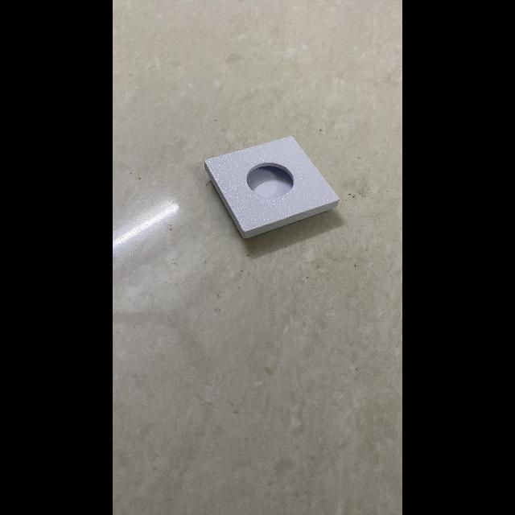 | 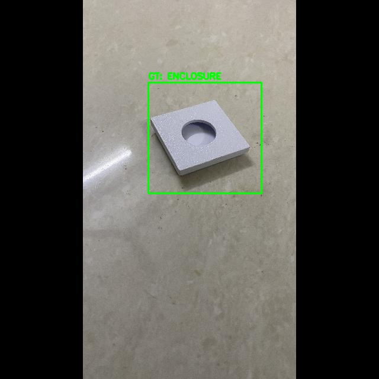 | **Source File:** `IMG_1026...` **Annotation:** Polygon segmentation tightly following enclosure profile. |
| **Train Sample 02** | 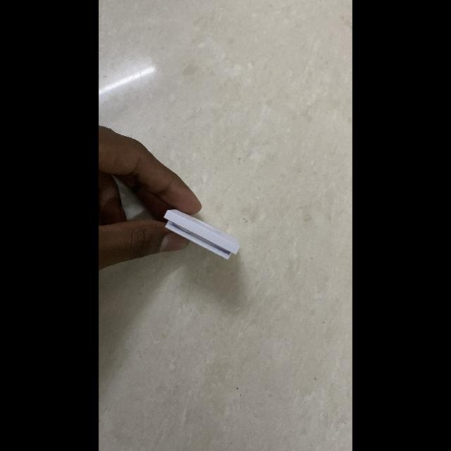 | 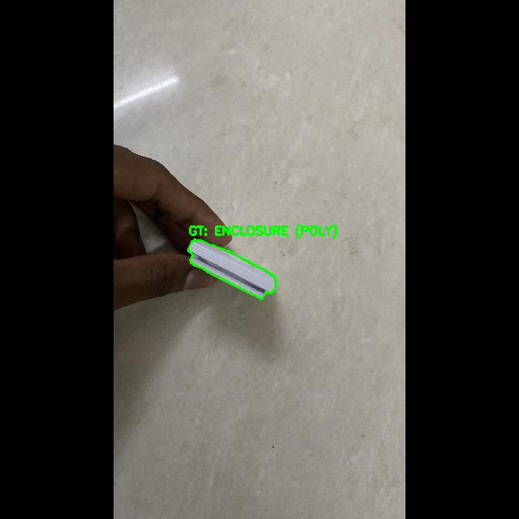 | **Source File:** `IMG_1027...` **Annotation:** Axis-aligned bounding box on tabletop with connected ribbon cable. |
| **Train Sample 03** | 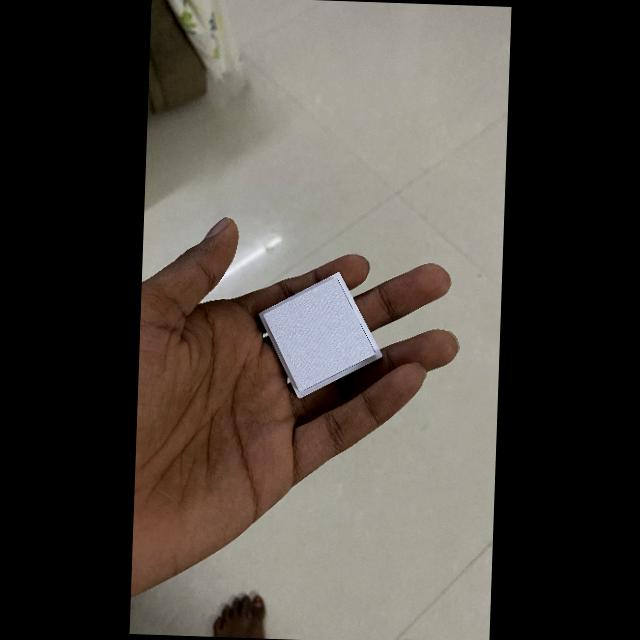 | 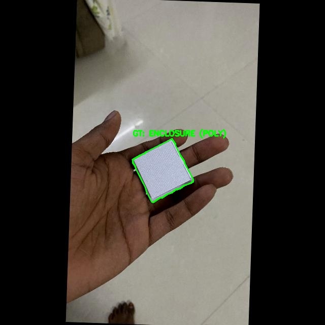 | **Source File:** `IMG_1031...` **Annotation:** Handheld orientation isolating enclosure from user fingers. |

---

### 4.2 Validation Set Visual Samples

Representative samples from [`datasets/Roboflow_M1_M2_V3/valid/images/`](../../../datasets/Roboflow_M1_M2_V3/valid/images/):

| Sample ID | Raw Exported Image (640×640) | Ground Truth Overlay | Annotation Breakdown |
| :---: | :---: | :---: | :--- |
| **Valid Sample 01** | 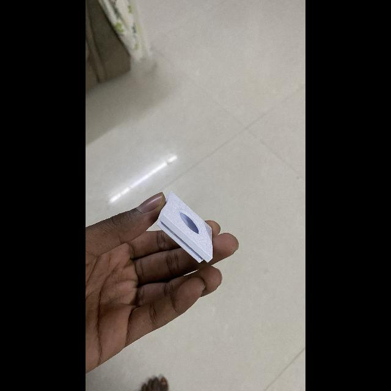 | 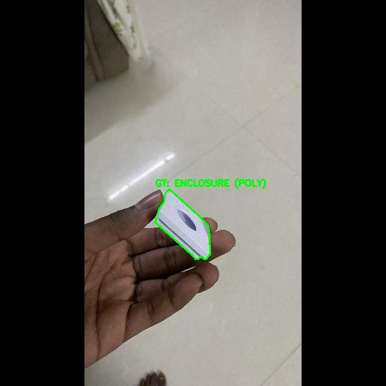 | **Source File:** `IMG_1033...` **Annotation:** Unaugmented validation target, centered optical lens alignment. |
| **Valid Sample 02** | 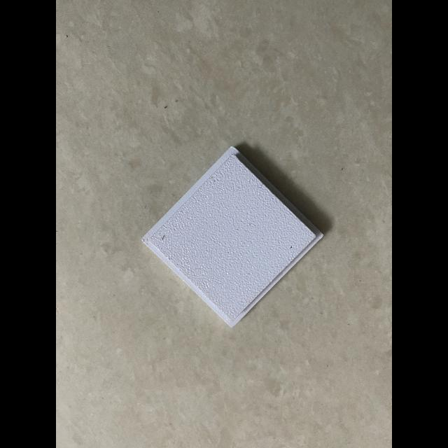 | 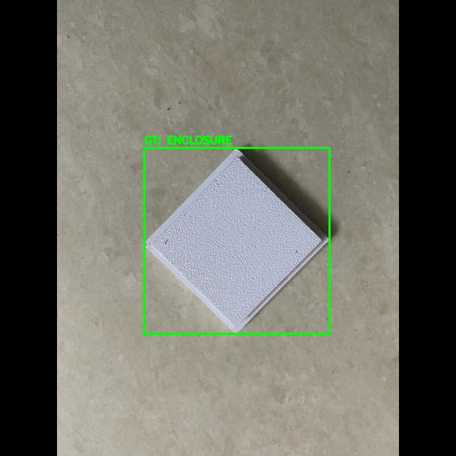 | **Source File:** `IMG_1057...` **Annotation:** Oblique angle validation case evaluating aspect ratio preservation. |
| **Valid Sample 03** | 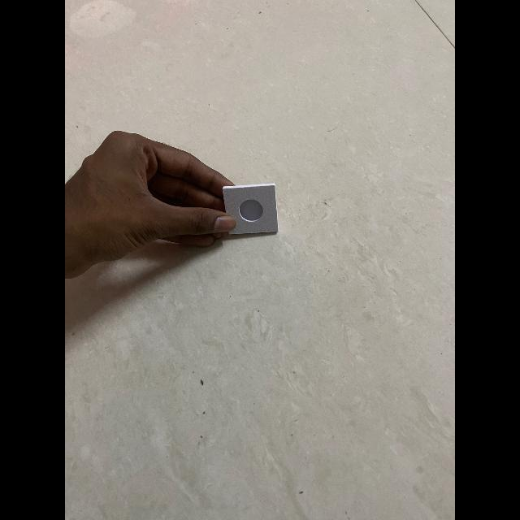 | 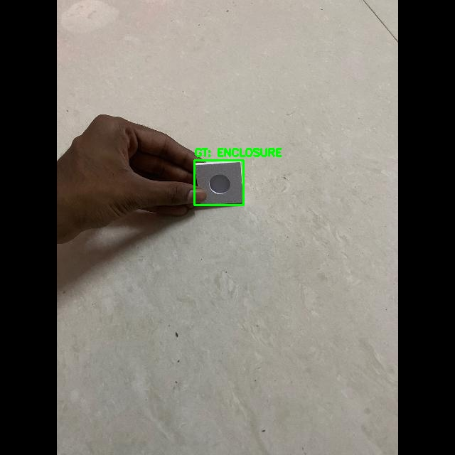 | **Source File:** `IMG_1095...` **Annotation:** Desk surface context under ambient shadow conditions. |

---

### 4.3 Testing Set Visual Samples

Representative samples from [`datasets/Roboflow_M1_M2_V3/test/images/`](../../../datasets/Roboflow_M1_M2_V3/test/images/):

| Sample ID | Raw Exported Image (640×640) | Ground Truth Overlay | Annotation Breakdown |
| :---: | :---: | :---: | :--- |
| **Test Sample 01** | 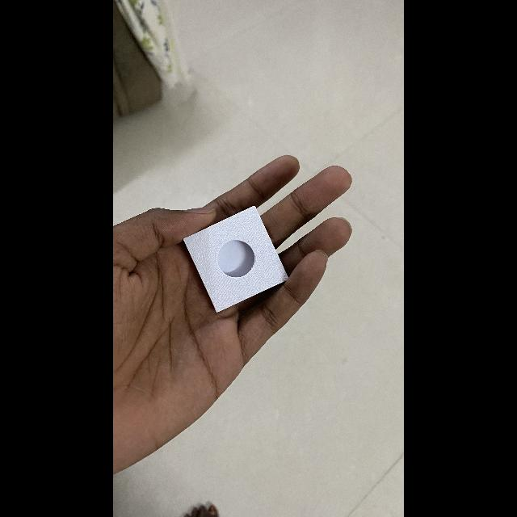 | 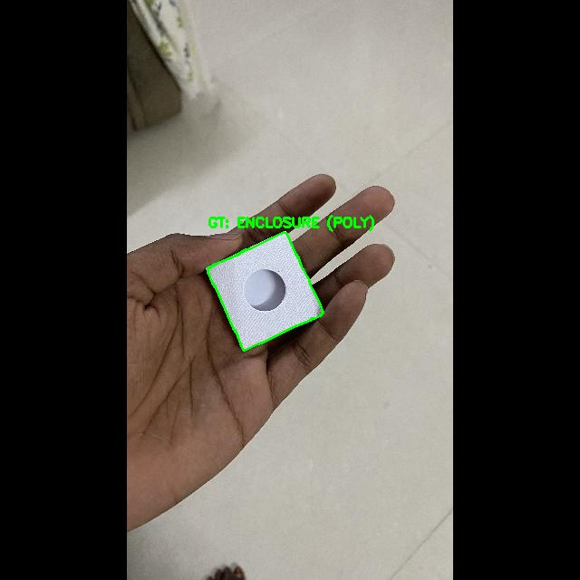 | **Source File:** `IMG_1032...` **Metric:** Held-out test target evaluating 99.31% mAP@50 benchmark. |
| **Test Sample 02** | 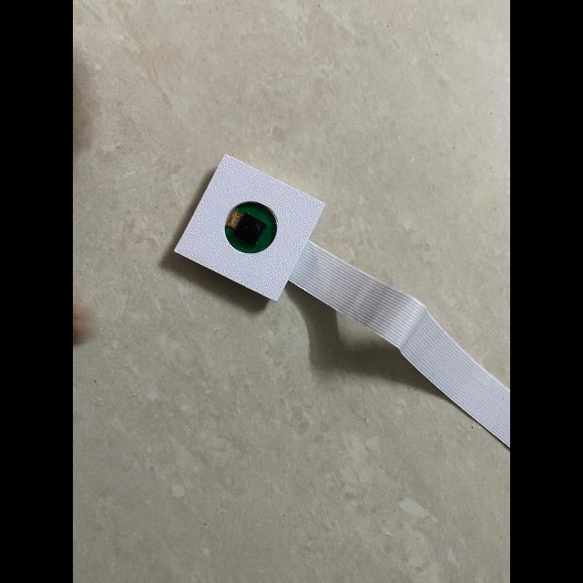 | 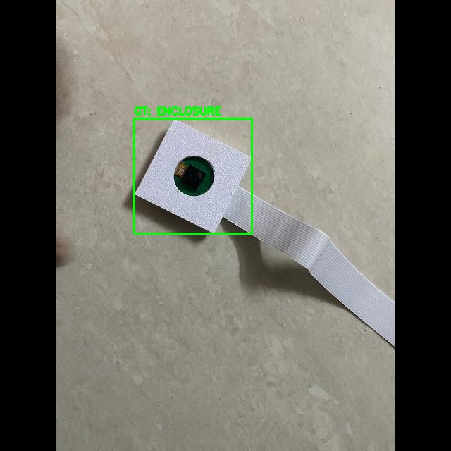 | **Source File:** `IMG_1104...` **Metric:** Resolves historical M1 multi-box defect into single verified prediction. |
| **Test Sample 03** | 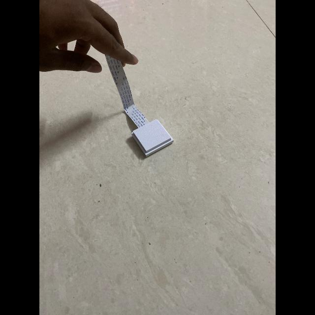 | 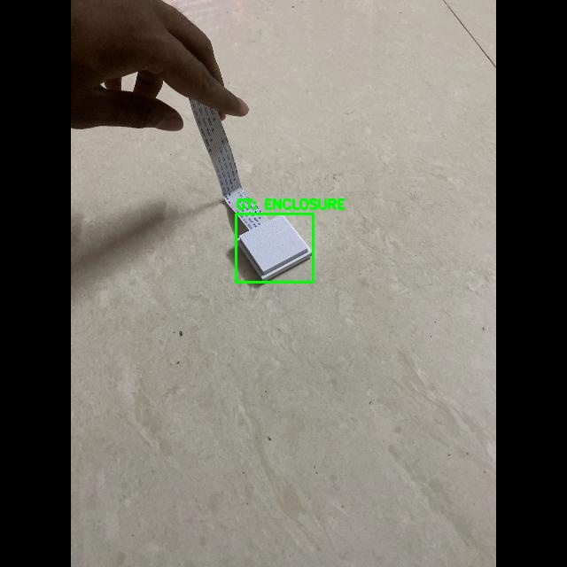 | **Source File:** `IMG_1125...` **Metric:** Distant tabletop perspective evaluating detector recall. |

---

## 5. Summary & Verification Conclusion

The dataset splits are cleanly structured, completely non-overlapping, and represent genuine real-world variations of the physical Raspberry Pi camera enclosure.
