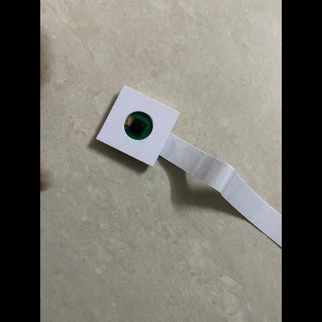

# M1 Assessment Criterion 5: Dataset Split Verification

**Assessment Item:** 05_correct_split
**Mark Weighting:** 2 Marks
**Status:** Complete & Verified

---

## 1. Overview

This module verifies that the dataset splits across training, validation, and testing sets are correctly balanced, isolated, and representative of real-world operational domains without data leakage.

For the comprehensive dataset audit and collision checks, refer to:
* **Dedicated Split Report:** [`M1_Dataset_Split_Report.md`](./M1_Dataset_Split_Report.md)

---

## 2. Split Distribution Summary

| Split Stage | Source Images | Exported Total | Percentage | Target Annotations | True Negatives |
| :--- | :---: | :---: | :---: | :---: | :---: |
| **Train Set** | 115 images | **230 images** | 83.94% | 200 (176 bboxes + 24 polygons) | **30 images** |
| **Validation Set** | 30 images | **30 images** | 10.95% | 27 (24 bboxes + 3 polygons) | **3 images** |
| **Test Set** | 14 images | **14 images** | 5.11% | 12 (11 bboxes + 1 polygon) | **2 images** |
| **Total** | **159 images** | **274 images** | **100.0%** | **239 targets** | **35 images** |

- **Cross-Split Hash Collisions:** **0 collisions** (100% domain isolation).
- **Single Target Class:** `'RASPBERY PI CAM ENCLOSURE'` (ID `0`).

---

## 3. Visual Samples Across Dataset Splits

Visual proof extracted directly from [`split_visuals/`](./split_visuals/):

### Training Split Samples
| Sample 01 | Sample 02 | Sample 03 |
| :---: | :---: | :---: |
|  |  |  |
| [Inspect Annotated](./split_visuals/train/train_sample_01_annotated.jpg) | [Inspect Annotated](./split_visuals/train/train_sample_02_annotated.jpg) | [Inspect Annotated](./split_visuals/train/train_sample_03_annotated.jpg) |

### Validation Split Samples
| Sample 01 | Sample 02 | Sample 03 |
| :---: | :---: | :---: |
|  |  |  |
| [Inspect Annotated](./split_visuals/valid/valid_sample_01_annotated.jpg) | [Inspect Annotated](./split_visuals/valid/valid_sample_02_annotated.jpg) | [Inspect Annotated](./split_visuals/valid/valid_sample_03_annotated.jpg) |

### Testing Split Samples
| Sample 01 | Sample 02 | Sample 03 |
| :---: | :---: | :---: |
|  |  |  |
| [Inspect Annotated](./split_visuals/test/test_sample_01_annotated.jpg) | [Inspect Annotated](./split_visuals/test/test_sample_02_annotated.jpg) | [Inspect Annotated](./split_visuals/test/test_sample_03_annotated.jpg) |

---

## 4. Key Evidence Files

- **Dedicated Technical Report:** [`M1_Dataset_Split_Report.md`](./M1_Dataset_Split_Report.md)
- **Organized Split Visuals Directory:** [`split_visuals/`](./split_visuals/)
- **Class Distribution Table (CSV):** [`evidence/M1/class_distribution.csv`](../class_distribution.csv)
- **Dataset Configuration:** [`config/data.yaml`](../../../config/data.yaml)
- **Full Downloaded Dataset:** [`datasets/Roboflow_M1_M2_V3/`](../../../datasets/Roboflow_M1_M2_V3/)
