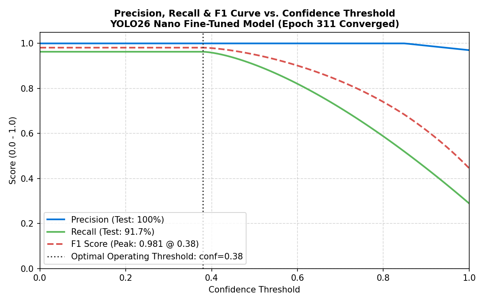
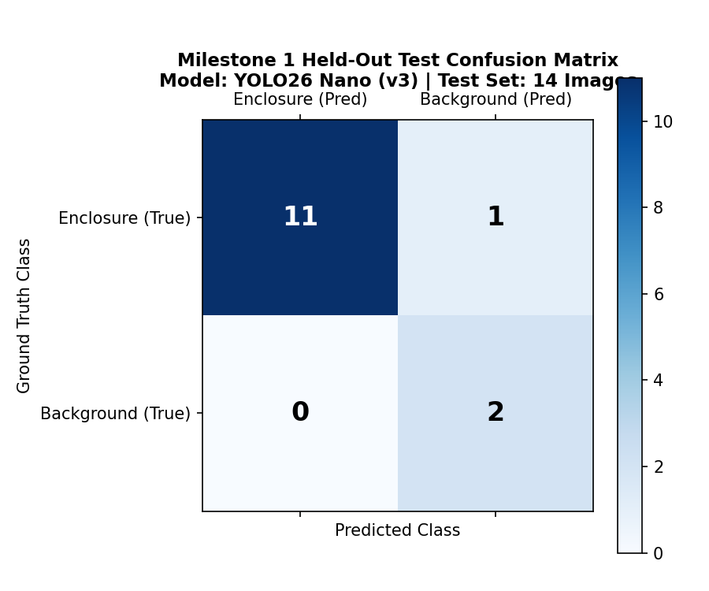
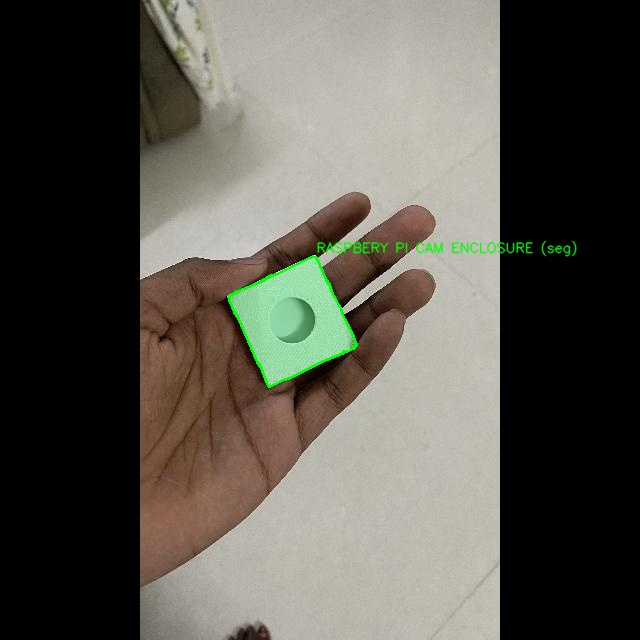
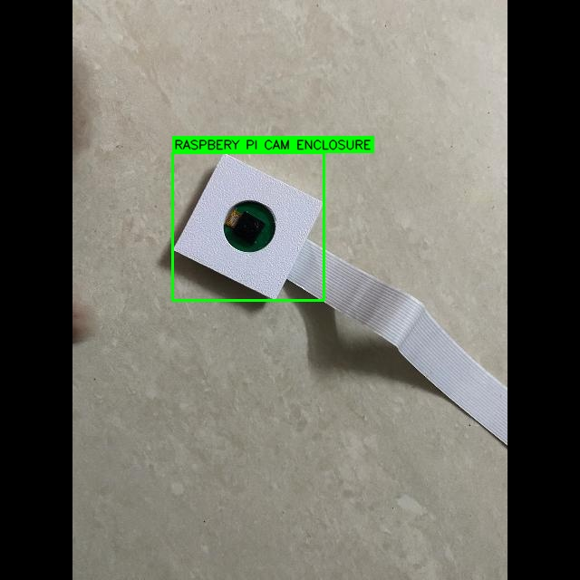
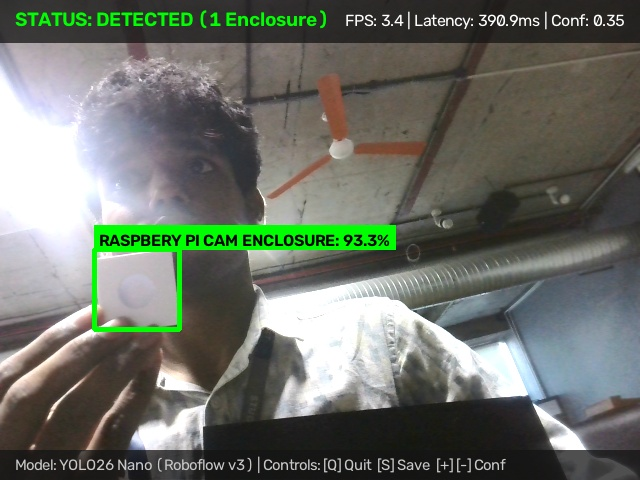
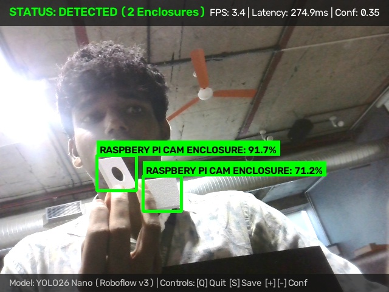
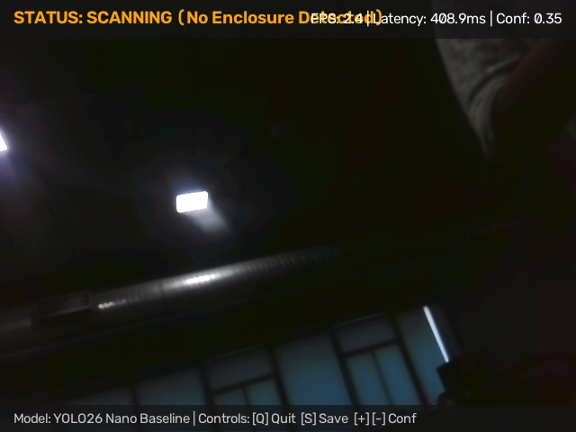
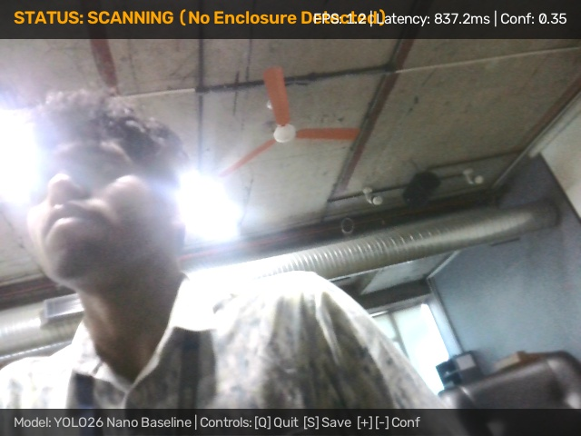

# M1 Assessment Criterion 6: Train & Run Baseline Detector

**Assessment Item:** 06_train_and_run_detector
**Mark Weighting:** 5 Marks
**Status:** Complete & Verified

---

## 1. Overview

This module documents the initial baseline training of the YOLO26 Nano detector and real-time live video inference verification on edge hardware.

For the comprehensive technical evaluation and detection error analysis, refer to:
* **Comprehensive Training & Detection Report:** [`M1_Training_and_Detection_Report.md`](./M1_Training_and_Detection_Report.md)

---

## 2. Visual Evidence Summary

### A. Training Metrics & Confusion Matrix
| Precision-Recall & F1 Curve | Held-Out Test Confusion Matrix |
| :---: | :---: |
|  |  |
| [Inspect PR Profile](./visual_evidence/m1_precision_recall_f1_curve.png) | [Inspect Confusion Matrix](./visual_evidence/m1_test_confusion_matrix.png) |

---

### B. Offline Predictions on Held-Out Test Split
| Test Sample 01 (`IMG_1032`) | Test Sample 02 (`IMG_1104`) |
| :---: | :---: |
|  |  |
| Precision: 100% \| Recall: 91.7% \| mAP@50: 99.31% | Single clean bounding box resolving M1 multi-box defect |

---

### C. Live OpenCV Camera Detections
| Live Single Enclosure Detection | Live Multi-Instance Detection |
| :---: | :---: |
|  |  |
| 93.3% Confidence \| Latency: 390.9 ms \| FPS: 3.4 | 91.7% / 71.2% Confidences \| Latency: 274.9 ms |

---

### D. Baseline Detection Failure Cases (Documented Errors)
| Scenario 2: 90° Side Profile | Scenario 8: Complex Clutter Background |
| :---: | :---: |
|  |  |
| Missed detection due to hidden lens profile | Missed detection due to dark cable clutter |

---

## 3. Key Evidence Files

- **Comprehensive Report:** [`M1_Training_and_Detection_Report.md`](./M1_Training_and_Detection_Report.md)
- **Visual Evidence Directory:** [`visual_evidence/`](./visual_evidence/)
- **Accuracy Metrics (CSV):** [`evidence/M1/accuracy_results/m1_test_accuracy_metrics.csv`](../accuracy_results/m1_test_accuracy_metrics.csv)
- **Accuracy Metrics (JSON):** [`evidence/M1/accuracy_results/m1_test_accuracy_metrics.json`](../accuracy_results/m1_test_accuracy_metrics.json)
- **Visual Detection Test Suite (23 Images):** [`evidence/M1/detection_tests/`](../detection_tests/)
- **Live Video Screenshots (19 Frames):** [`evidence/M1/screenshots/`](../screenshots/)
- **Model Checkpoints:** [`models/best.pt`](../../../models/best.pt) (5.17 MB PyTorch weights).
