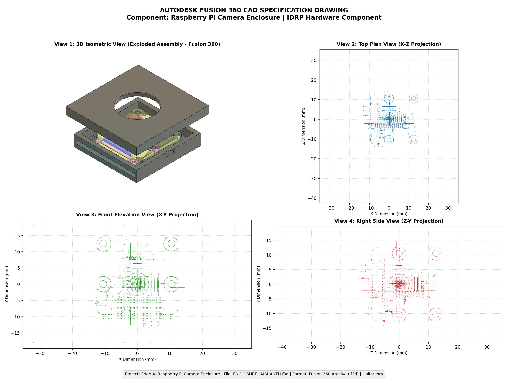

# CAD Design Specification: Raspberry Pi Camera Enclosure

**Project:** Edge AI Object Detection System  
**Hardware ID:** IDRP-HW-CAM-ENC-01  
**Part Name:** Raspberry Pi Camera Protective Enclosure  
**Design Authority:** Jaishanth  
**CAD Model File:** [`ENCLOSURE_JAISHANTH.f3d`](./ENCLOSURE_JAISHANTH.f3d)  
**Native Format:** Autodesk Fusion 360 Document Archive (`.f3d`)  
**Target Camera:** Raspberry Pi Camera Module v2 / v3 (standard form factor)  

---

## 1. Scope & Objective

This specification defines the mechanical geometry, mounting interfaces, manufacturing tolerances, and operational constraints for the custom Raspberry Pi Camera Enclosure. This enclosure was modeled in Autodesk Fusion 360 to provide a dedicated, lightweight, and durable housing for edge computer vision deployments.

---

## 2. Technical Drawing & Multi-View Projections



```
========================================================================================
                                 PROJECTION MATRIX
========================================================================================
View                   Coordinate Planes       Visible Features
----------------------------------------------------------------------------------------
View 1: 3D Isometric   3D Perspective          Exploded assembly, top lid, base, PCB
View 2: Top Plan       X-Z Projection          Lens aperture, standoff pattern, footprint
View 3: Front Elev.    X-Y Projection          Standoff rings, optical axis alignment
View 4: Right Side     Z-Y Projection          FFC ribbon exit slot, joint seam profile
========================================================================================
```

---

## 3. Dimensional Specifications (Extracted from Original CAD)

All values are derived directly from the analytical geometry of [`ENCLOSURE_JAISHANTH.f3d`](./ENCLOSURE_JAISHANTH.f3d):

| Feature | Value | Tolerance | Description |
| :--- | :--- | :--- | :--- |
| **Footprint Width ($X$)** | **64.0 mm** | $\pm 0.2\text{ mm}$ | Outer housing width |
| **Footprint Length ($Z$)** | **71.0 mm** | $\pm 0.2\text{ mm}$ | Outer housing length (including flange) |
| **Exploded Height ($Y$)** | **36.0 mm** | $\pm 0.3\text{ mm}$ | Height in exploded state |
| **Assembled Chassis Height** | **~18.0 mm** | $\pm 0.2\text{ mm}$ | Combined base + lid height |
| **Lens Viewport Aperture** | **Ø 16.0 mm** | $+0.2/-0.0\text{ mm}$ | Circular optical opening |
| **Aperture Center ($X, Z$)** | **$(0.0, 0.0)\text{ mm}$** | $\pm 0.05\text{ mm}$ | Aligned with camera optical axis |
| **Standoff Spacing ($X$)** | **21.0 mm** | $\pm 0.1\text{ mm}$ | Distance between standoff centers ($X = \pm 10.5\text{ mm}$) |
| **Standoff Spacing ($Y/Z$)** | **12.5 mm** | $\pm 0.1\text{ mm}$ | Distance between standoff centers ($Y = 0.0\text{ to } 12.5\text{ mm}$) |
| **Standoff Outer Diameter** | **Ø 4.5 mm** | $\pm 0.1\text{ mm}$ | Support boss outer diameter |
| **Standoff Pilot Hole** | **Ø 2.2 mm** | $+0.1/-0.0\text{ mm}$ | Sized for M2 heat-set inserts or screws |
| **FFC Ribbon Cable Slot** | **18.0 mm × 2.5 mm** | $+0.3/-0.0\text{ mm}$ | Lateral slot for 15-pin 16 mm ribbon cable |
| **Wall Thickness** | **2.0 mm – 2.5 mm** | $\pm 0.15\text{ mm}$ | Perimeter enclosure wall |

---

## 4. Mechanical & Assembly Interface

```
+---------------------------------------------------------------------+
|                          EXPLODED STACK-UP                          |
+---------------------------------------------------------------------+
|   [ TOP LID ]             Outer: 64 mm x 71 mm, Aperture: Ø 16 mm   |
|        |                                                            |
|        v                  Alignment Lip (Mates into base recess)    |
|   [ CAMERA PCB ]          25 mm x 24 mm Raspberry Pi Camera Module  |
|        |                                                            |
|        v                  4x Standoffs (21.0 mm x 12.5 mm spacing)  |
|   [ BASE HOUSING ]        Lower cavity + FFC side exit slot         |
+---------------------------------------------------------------------+
```

1. **Camera Retention:** The camera module rests on four precision standoffs molded directly into the base housing. M2 self-tapping screws or M2 heat-set threaded inserts secure the PCB.
2. **Cable Routing:** The flat ribbon cable exits horizontally through the dedicated 18 mm × 2.5 mm slot on the side wall, preventing pinched wires and signal degradation.
3. **Lid Closure:** The top lid engages with the base using a perimeter alignment lip with friction snap retention.

---

## 5. Material & Environmental Specifications

| Property | Value | Notes |
| :--- | :--- | :--- |
| **CAD Material Model** | Generic Polymer Asset | Autodesk Protein Asset definition in Fusion 360 |
| **Recommended Physical Material** | **PLA (Polylactic Acid)** or **PETG** | Standard additive manufacturing polymers |
| **Recommended Color** | Matte Dark Grey / Black | Reduces internal lens reflections and glare |
| **Operating Temperature** | $-10^\circ\text{C}$ to $+60^\circ\text{C}$ (PLA) | Up to $+75^\circ\text{C}$ if printed in PETG |
| **Mass (Estimated PLA, 20% infill)**| **~28 to 35 grams** | Lightweight for edge robotic payloads |

---

## 6. Manufacturing Guidelines (3D Printing / Additive)

- **Process:** Fused Deposition Modeling (FDM / FFF).
- **Nozzle Diameter:** 0.4 mm standard.
- **Layer Height:** 0.20 mm recommended (0.16 mm for smoother surface finish).
- **Perimeters / Shells:** 3 perimeters minimum (1.2 mm wall thickness).
- **Infill:** 20% Gyroid or Grid infill.
- **Orientation:**
  - **Top Lid:** Print top-face flat on build plate (no supports required).
  - **Base Housing:** Print base-face flat on build plate (supports required only inside the ribbon cable slot).
- **Post-Processing:** Clean minor stringing; verify standoff diameter before installing screws.

---

## 7. Traceability & Links

- **Original CAD File:** [`ENCLOSURE_JAISHANTH.f3d`](https://github.com/jaishanthlenin-123/edge_ai_m1_m2/blob/main/evidence/M1/07_cad_design/ENCLOSURE_JAISHANTH.f3d)
- **CAD Evidence Folder:** [`evidence/M1/07_cad_design/`](https://github.com/jaishanthlenin-123/edge_ai_m1_m2/tree/main/evidence/M1/07_cad_design/)
- **Comprehensive CAD Design Report:** [`M1_CAD_Design_Report.md`](./M1_CAD_Design_Report.md)
- **CAD File Information & Forensics:** [`CAD_File_Information.md`](./CAD_File_Information.md)

