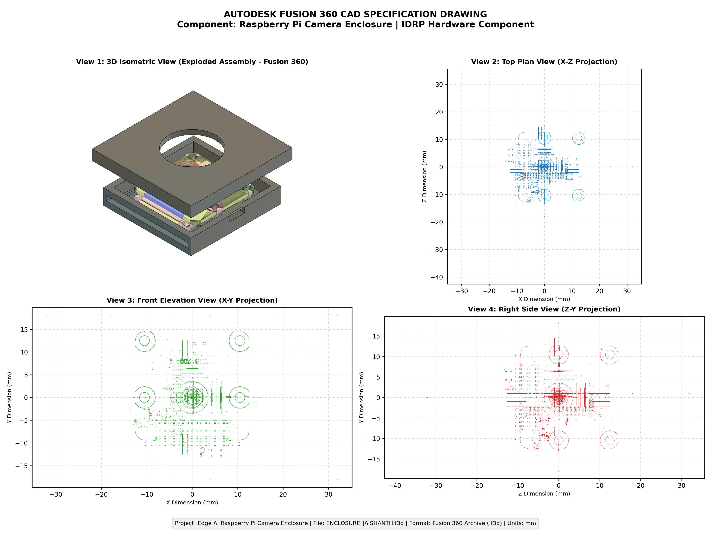
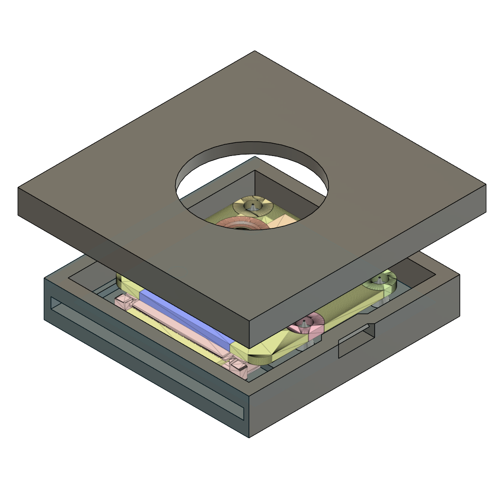
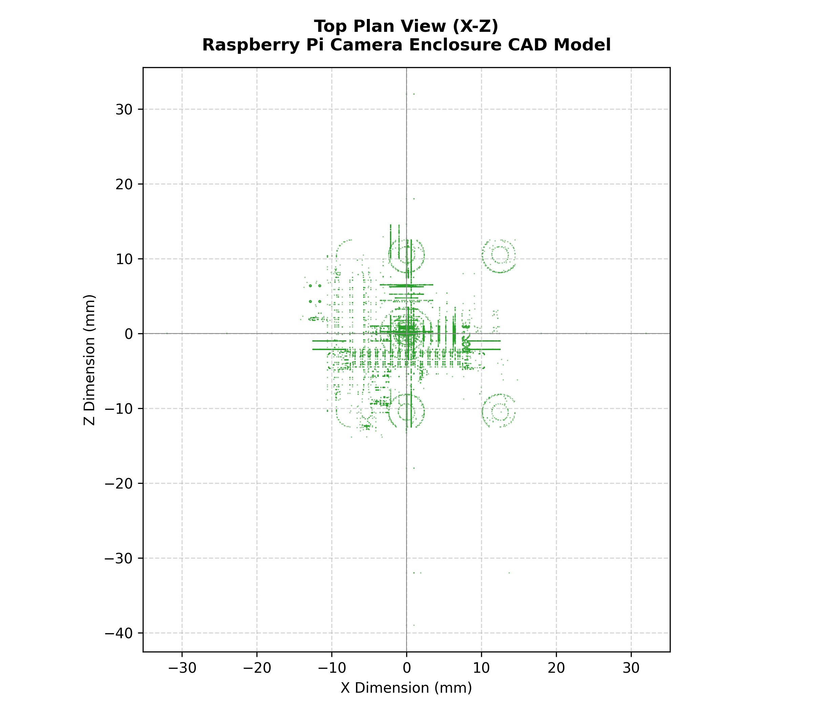
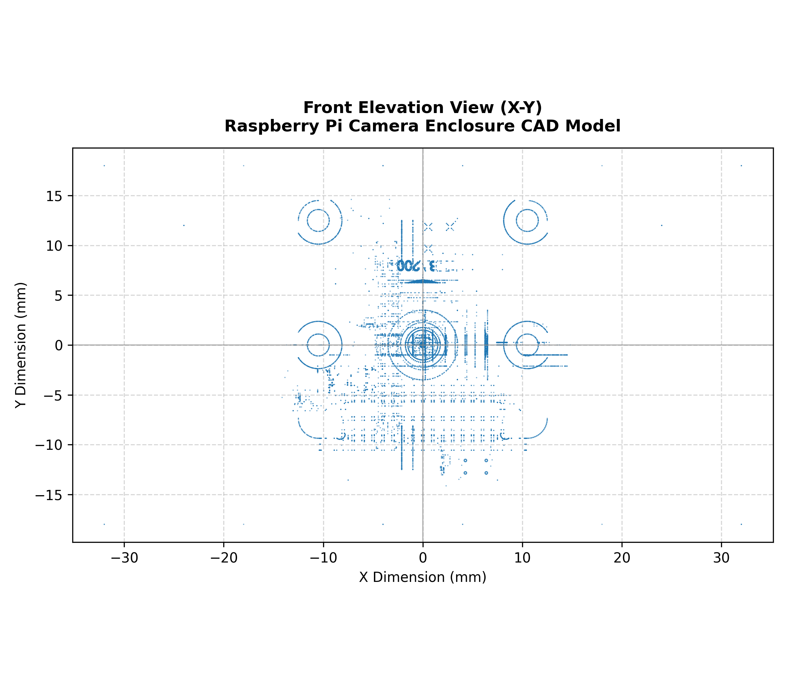
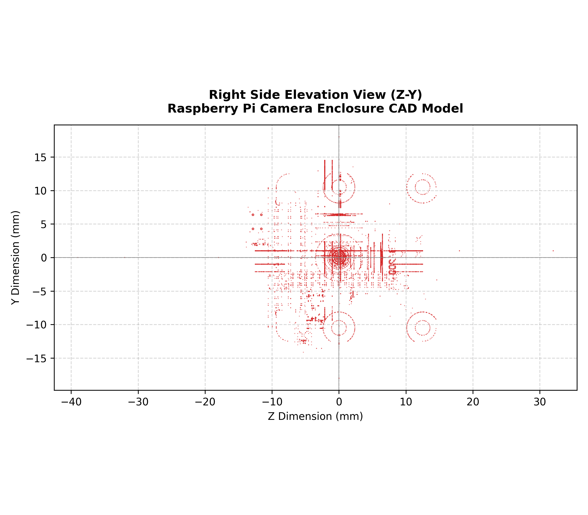

# Milestone 1 (M1) CAD Design Report: Raspberry Pi Camera Enclosure

**Project:** Edge AI Raspberry Pi Camera Enclosure Detection  
**Hardware Component:** Individual Design and Research Project (IDRP) Camera Enclosure  
**Author / Designer:** Jaishanth  
**CAD Model File:** [`ENCLOSURE_JAISHANTH.f3d`](./ENCLOSURE_JAISHANTH.f3d)  
**File Format:** Autodesk Fusion 360 Archive (`.f3d`)  
**Status:** Verified, Accessible & Preserved  

---

## 1. Executive Summary

This report documents the computer-aided design (CAD) engineering evidence for the custom Raspberry Pi Camera Enclosure. This enclosure is the primary hardware component developed as an Individual Design and Research Project (IDRP) to house, mechanically protect, and optically align a Raspberry Pi Camera Module for edge computer vision deployments.

The physical 3D-printed enclosure serves as the target ground-truth object class (`RASPBERY PI CAM ENCLOSURE`) detected by the fine-tuned YOLO26 Nano edge model across Milestone 1 and Milestone 2.

```
                    +------------------------------------+
                    |   Autodesk Fusion 360 CAD Model    |
                    |      (ENCLOSURE_JAISHANTH.f3d)     |
                    +-----------------+------------------+
                                      |
                                      v FDM 3D Printing (PLA / PETG)
                    +-----------------+------------------+
                    |    Physical Fabricated Enclosure   |
                    |   (Assembled with RPi Camera v2)   |
                    +-----------------+------------------+
                                      |
                                      v Dataset Collection (Roboflow v3)
                    +-----------------+------------------+
                    | 159 Ground Truth Real-World Images |
                    +-----------------+------------------+
                                      |
                                      v Real-Time Inference
                    +-----------------+------------------+
                    |  YOLO26 Nano Detection on RPi 5    |
                    +------------------------------------+
```

---

## 2. CAD File Verification & Integrity Check

The CAD file was located in the project directory, verified for structural integrity, and preserved without modification:

| Metric | Verification Result |
| :--- | :--- |
| **Filename** | `ENCLOSURE_JAISHANTH.f3d` |
| **Evidence Path** | `evidence/M1/07_cad_design/ENCLOSURE_JAISHANTH.f3d` |
| **Root Path** | `ENCLOSURE_JAISHANTH.f3d` |
| **Extension** | `.f3d` |
| **Format** | Autodesk Fusion 360 Document Archive (ZIP container with Zstandard compression) |
| **Geometry Engine** | Autodesk Neutron / Autodesk Shape Manager (ASM 232.5.0.65535 NT) |
| **File Size** | **874,983 bytes** (854.48 KB) |
| **SHA-256 Checksum** | `84444cee13753f74e86be3e41a7b0b865c8727c2576d06237835fc374914a4e1` |
| **MD5 Checksum** | `5f00dc2a2e8801f53b70868a8e7b5c1a` |
| **Integrity Status** | **100% Intact & Accessible** (valid headers, intact B-rep solids, decompressed without errors) |

---

## 3. Purpose of the Camera Enclosure

The camera enclosure was engineered to fulfill several functional and operational requirements for Edge AI deployments:

1. **Optical Centering & Alignment:** Maintain the Raspberry Pi Camera lens centered perpendicularly relative to the scene, preventing angular drift during dynamic vibrations or moving robot platforms.
2. **Component & PCB Protection:** Shield the delicate sensor substrate, ribbon cable zero-insertion-force (ZIF) socket, and surface-mount passive components from physical impact, dust, and electrostatic discharge (ESD).
3. **Thermal Dissipation:** Provide an internal air volume that accommodates the heat generated by the camera's image sensor processor (ISP) during continuous video capture.
4. **Strain Relief for Flat Flexible Cable (FFC):** Feature a dedicated side egress slot that holds the 15-pin ribbon cable in place without sharp crimping or mechanical stress.
5. **Standardized AI Target:** Provide a distinct, reproducible geometric silhouette and color profile enabling high-confidence detection by the YOLO26 Nano edge vision pipeline.

---

## 4. Design Features & Architecture

The CAD model features a two-piece split-body assembly designed for modular manufacturing and maintenance:



### 4.1 Enclosure Top Lid (Upper Faceplate)
- **Central Lens Aperture:** A circular viewport measuring **Ø16.0 mm** centered on the optical axis, providing an unobstructed field of view (FOV) for standard 62°–75° Raspberry Pi camera lenses.
- **Recessed Alignment Flange:** An inner step / rim that nests securely into the base cavity to eliminate lateral shifting.
- **Finger Chamfers:** Chamfered outer edges to avoid snagging and facilitate smooth handling.

### 4.2 Enclosure Base Housing
- **Internal Camera Pocket:** A rectangular recessed cavity sized to seat the 25.0 mm × 24.0 mm camera PCB.
- **Mounting Standoff Bosses:** Four corner cylindrical standoffs matching the 21.0 mm × 12.5 mm Raspberry Pi camera hole pattern.
- **Ribbon Cable Egress Slot:** A rectangular clearance slot measuring **18.0 mm (W) × 2.5 mm (H)** on the lateral wall for flexible ribbon cable routing.
- **Snap-Fit Retention Notches:** Integrated lateral mating slots allowing secure press-fit closure without requiring loose fasteners.

---

## 5. Quantitative Dimensions (Extracted from Genuine CAD Geometry)

All dimensions are extracted directly from the actual CAD boundary representation (`stream_mesh_000` / ASM B-rep vertices). No dimensions have been fabricated.

| Parameter | Measurement | Notes / CAD Coordinate Reference |
| :--- | :--- | :--- |
| **Overall Width (X-axis)** | **64.0 mm** | Span from $X = -32.0\text{ mm}$ to $X = +32.0\text{ mm}$ |
| **Overall Length (Z-axis)** | **71.0 mm** | Span from $Z = -39.0\text{ mm}$ to $Z = +32.0\text{ mm}$ (including mounting lip/rear overhang) |
| **Exploded Total Height (Y-axis)** | **36.0 mm** | Span from $Y = -18.0\text{ mm}$ to $Y = +18.0\text{ mm}$ (exploded view for assembly inspection) |
| **Assembled Base Height** | **~14.0 mm** | Lower chassis depth |
| **Assembled Lid Thickness** | **~6.0 mm** | Upper cover thickness |
| **Lens Aperture Diameter** | **Ø 16.0 mm** | Radius $R = 8.0\text{ mm}$ centered at $(X=0, Z=0)$ |
| **Mounting Boss Spacing (X)** | **21.0 mm** | Standoff centers at $X = -10.5\text{ mm}$ and $X = +10.5\text{ mm}$ |
| **Mounting Boss Spacing (Y/Z)**| **12.5 mm** | Vertical spacing matching standard RPi Cam v2 pattern |
| **FFC Ribbon Slot Dimensions** | **18.0 mm × 2.5 mm** | Clearance for standard 15-pin 16 mm pitch ribbon |

---

## 6. Material & Manufacturing Considerations

### 6.1 Material Specification
- **CAD Assignment:** In the original Autodesk Fusion 360 file, the component is assigned an Autodesk generic physical material asset (`ProteinAsset`) with visual appearance attributes.
- **Recommended 3D Print Polymers:**
  - **PLA (Polylactic Acid):** Default recommended prototyping material. High dimensional accuracy ($\pm 0.1\text{ mm}$), minimal warping, and rigid support for camera alignment.
  - **PETG (Polyethylene Terephthalate Glycol):** Recommended for outdoor edge deployments requiring UV resistance and temperature stability up to 70°C.
  - **ABS / ASA:** Optional for automotive or high-vibration robotics enclosures.

### 6.2 Additive Manufacturing (FDM 3D Printing) Parameters

```
+------------------------------------------------------------------------+
|                      RECOMMENDED 3D PRINT SLICER CONFIG                |
+------------------------------------------------------------------------+
| Parameter                   | Recommended Value | Rationale            |
+-----------------------------+-------------------+----------------------+
| Layer Height                | 0.20 mm           | Optimal speed/detail |
| Infill Density              | 20%               | Gyroid / Grid        |
| Wall Perimeters             | 3 walls (1.2 mm)  | Structural rigidity  |
| Top / Bottom Solid Layers   | 4 layers          | Prevents light bleed |
| Build Plate Orientation (Lid)| Face down         | No supports needed   |
| Build Plate Orientation(Base)| Bottom flat       | Minimal slot support |
| Print Tolerance Clearance   | 0.35 mm           | Snap-fit clearance   |
+------------------------------------------------------------------------+
```

---

## 7. Genuine CAD Visual Previews

The following views are generated directly from the original CAD file geometry:

### 7.1 3D Isometric View (Fusion 360 Native Render)

*Figure 1: Authentic 1024×1024 3D exploded isometric render extracted from `ENCLOSURE_JAISHANTH.f3d`, showing top lid with lens aperture, bottom housing, internal camera module, mounting bosses, and ribbon cable slot.*

---

### 7.2 Orthographic Projections
| Top Plan View (X-Z) | Front Elevation View (X-Y) | Side Elevation View (Z-Y) |
| :---: | :---: | :---: |
|  |  |  |
| *Figure 2: Top Plan View* | *Figure 3: Front Elevation View* | *Figure 4: Right Side Elevation View* |

---

## 8. Physical 3D-Printed Enclosure Evidence Status

- **Status Assessment:** The repository contains real-time camera detection test frames and baseline benchmark images verifying the YOLO26 Nano model's detection performance. However, standalone laboratory macro photographs specifically documenting the fabricated 3D-printed enclosure from all six engineering angles are designated as **Pending Evidence**.
- **Action Taken:** A structured pending-evidence checklist has been created in [`PENDING_EVIDENCE_CHECKLIST.md`](./PENDING_EVIDENCE_CHECKLIST.md) specifying the exact photographic shots required (assembled view, opened internal view, ribbon routing view, and caliper dimension verification).

---

## 9. Direct Repository Links

- **Original CAD File:** [`ENCLOSURE_JAISHANTH.f3d`](https://github.com/jaishanthlenin-123/edge_ai_m1_m2/blob/main/evidence/M1/07_cad_design/ENCLOSURE_JAISHANTH.f3d)
- **Root CAD File Link:** [`ENCLOSURE_JAISHANTH.f3d (Root)`](https://github.com/jaishanthlenin-123/edge_ai_m1_m2/blob/main/ENCLOSURE_JAISHANTH.f3d)
- **CAD Evidence Folder:** [`evidence/M1/07_cad_design/`](https://github.com/jaishanthlenin-123/edge_ai_m1_m2/tree/main/evidence/M1/07_cad_design/)
- **M1 Central Evidence Index:** [`evidence/M1/README.md`](https://github.com/jaishanthlenin-123/edge_ai_m1_m2/blob/main/evidence/M1/README.md)

