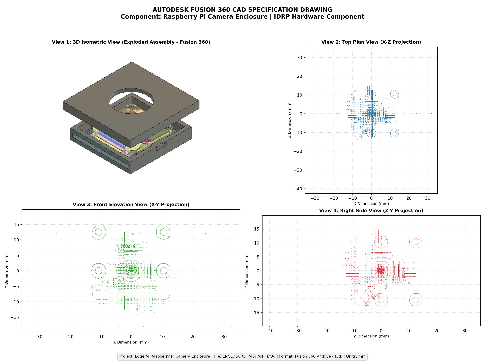

# CAD Design Evidence: Raspberry Pi Camera Enclosure

**Assessment Item:** 07_cad_design
**Hardware Component:** Individual Design and Research Project (IDRP)
**Designer:** Jaishanth
**Native Model File:** [`ENCLOSURE_JAISHANTH.f3d`](./ENCLOSURE_JAISHANTH.f3d)
**Direct GitHub CAD File Link:** [`ENCLOSURE_JAISHANTH.f3d`](https://github.com/jaishanthlenin-123/edge_ai_m1_m2/blob/main/evidence/M1/07_cad_design/ENCLOSURE_JAISHANTH.f3d)
**Status:** Verified, Accessible & Preserved

---

## 1. Overview

This directory contains the computer-aided design (CAD) models, engineering drawings, specifications, and verification records for the custom Raspberry Pi Camera Enclosure. This enclosure was modeled in Autodesk Fusion 360 as the physical hardware component for the Edge AI detection pipeline.

---

## 2. CAD File Verification & Integrity

- **Filename:** `ENCLOSURE_JAISHANTH.f3d`
- **File Format:** Autodesk Fusion 360 Document Archive (`.f3d`)
- **Kernel:** Autodesk Neutron / Autodesk Shape Manager (ASM 232.5.0.65535 NT)
- **File Size:** **874,983 bytes** (854.48 KB / ~875 KB)
- **SHA-256 Checksum:** `84444cee13753f74e86be3e41a7b0b865c8727c2576d06237835fc374914a4e1`
- **MD5 Checksum:** `5f00dc2a2e8801f53b70868a8e7b5c1a`
- **Integrity Status:** **100% Intact & Accessible**

---

## 3. Genuine Engineering Previews

| View | File Link | Description |
| :--- | :--- | :--- |
| **3D Isometric View** | [`cad_isometric_view.png`](./cad_isometric_view.png) | 1024×1024 native Fusion 360 exploded assembly render |
| **Top Plan View (X-Z)** | [`cad_top_view.png`](./cad_top_view.png) | Top elevation view showing standoffs and aperture |
| **Front Elevation View (X-Y)** | [`cad_front_view.png`](./cad_front_view.png) | Front elevation showing lens viewport and optical center |
| **Side Elevation View (Z-Y)** | [`cad_side_view.png`](./cad_side_view.png) | Lateral profile showing ribbon cable egress slot |
| **4-View Drawing Sheet** | [`cad_multi_view_drawing.png`](./cad_multi_view_drawing.png) | Composite engineering drawing with coordinate axes |

---

## 4. Documentation Index

- **[`M1_CAD_Design_Report.md`](./M1_CAD_Design_Report.md):** Full engineering report covering IDRP hardware objectives, functional features, 3D print slicer parameters, and connection to the YOLO26 Nano detection class.
- **[`CAD_Design_Specification.md`](./CAD_Design_Specification.md):** Technical specification sheet detailing dimensions (64 mm × 71 mm × 36 mm exploded / ~18 mm assembled), mounting boss pattern (21.0 mm × 12.5 mm), Ø 16 mm aperture, and tolerances.
- **[`CAD_File_Information.md`](./CAD_File_Information.md):** File metadata, archive data streams, ASM B-rep bodies, checksum verification, and viewer guide.
- **[`PENDING_EVIDENCE_CHECKLIST.md`](./PENDING_EVIDENCE_CHECKLIST.md):** Photography checklist for physical 3D-printed enclosure evidence.
