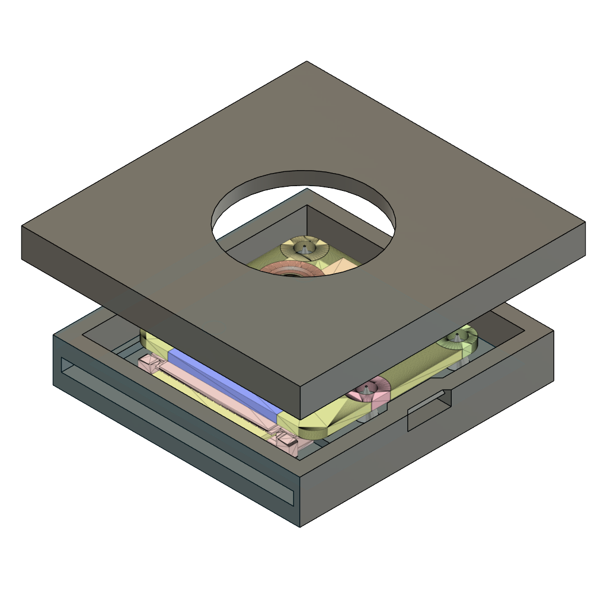
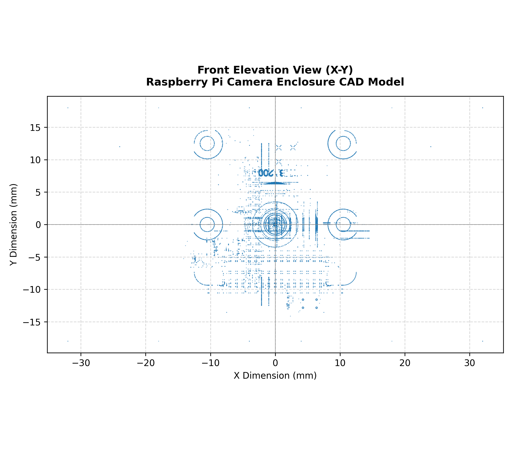
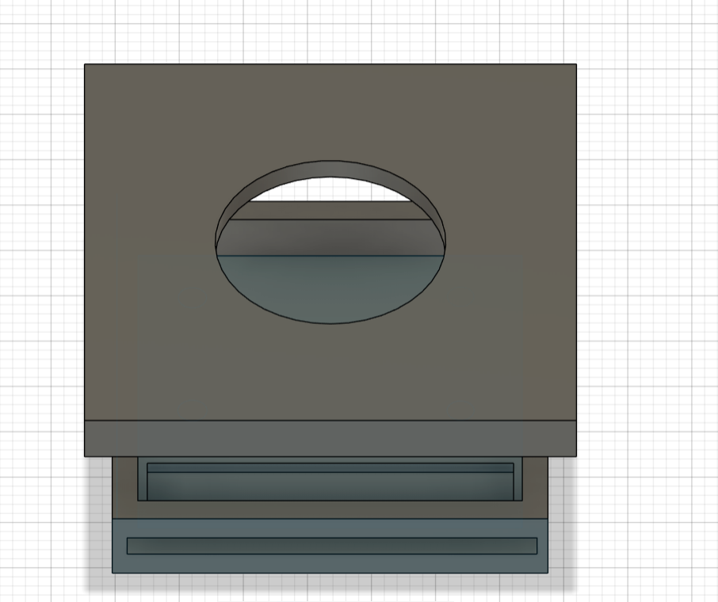
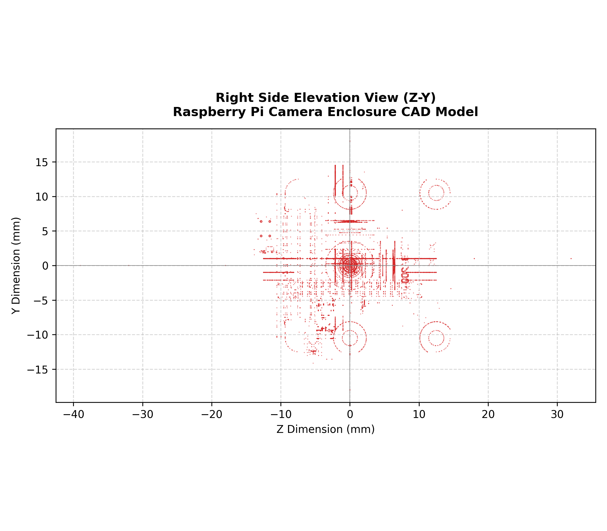
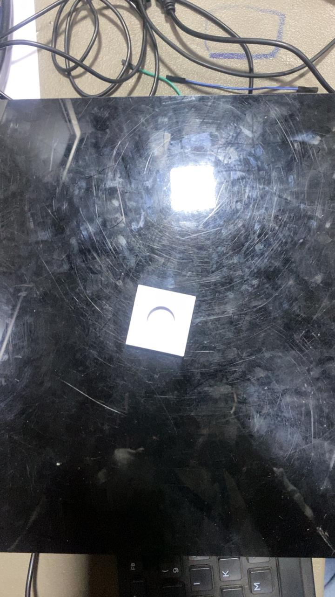

# Milestone 1 (M1) Central Evidence Index & Navigation Matrix

This directory serves as the primary evaluation portal for **Milestone 1 (M1)** of the Edge AI Raspberry Pi Camera Enclosure Detection project. It aggregates all experimental verification records, baseline benchmarks, dataset audit artifacts, the hardware CAD engineering evidence, and the **Roboflow Dataset Version 3** integration.

---

## 1. M1 Assessment Navigation & Visual Evidence Matrix

All Milestone 1 assessment requirements are systematically indexed below with direct repository navigation to reports, data logs, and embedded genuine visual evidence:

| # | Assessment Category | Marks | Dedicated Engineering Report | Visual Evidence Directory | Description & Key Deliverables |
| :-: | :--- | :-: | :--- | :--- | :--- |
| **01** | **Camera & Repo Setup** | **2** | [`01_camera_and_repo/README.md`](./01_camera_and_repo/README.md) | [`01_camera_and_repo/camera_visuals/`](./01_camera_and_repo/camera_visuals/) | Initial camera frame capture, device binding (`/dev/video0`), dual camera driver (`src/camera.py`), remote repository link |
| **02** | **OpenCV Pipeline** | **4** | [`M1_OpenCV_Pipeline_Report.md`](./02_opencv_pipeline/M1_OpenCV_Pipeline_Report.md) | [`02_opencv_pipeline/detection_screenshots/`](./02_opencv_pipeline/detection_screenshots/) | Real-time video loop, 640×640 letterboxing, HUD telemetry overlays, 5 genuine live detection screenshots |
| **03** | **Baseline Speed Benchmark**| **3** | [`M1_Baseline_Performance_Report.md`](./M1_Baseline_Performance_Report.md) | [`03_baseline_speed/benchmark_visuals/`](./03_baseline_speed/benchmark_visuals/) | Unaccelerated PyTorch CPU latency (301.1 ms avg / 8,880.5 ms cold-start), 262-frame CSV logs, CPU/temp plots |
| **04** | **Dataset Version 1 Audit & v3** | **4** | [`dataset_audit_report.md`](./dataset_audit_report.md) | [`04_dataset_v1/original_m1_audit_visuals/`](./04_dataset_v1/original_m1_audit_visuals/) & [`roboflow_v3_previews/`](./04_dataset_v1/roboflow_v3_previews/) | 124-image audit, skin contamination proof, error catalog, evolution to Version 3 (24 raw & annotated previews) |
| **05** | **Correct Split Verification**| **2** | [`M1_Dataset_Split_Report.md`](./05_correct_split/M1_Dataset_Split_Report.md) | [`05_correct_split/split_visuals/`](./05_correct_split/split_visuals/) | Split distribution (Train: 230, Valid: 30, Test: 14), 0 hash collisions, 9 split samples (train/valid/test pairs) |
| **06** | **Train & Run Detector** | **5** | [`M1_Training_and_Detection_Report.md`](./06_train_and_run_detector/M1_Training_and_Detection_Report.md) | [`06_train_and_run_detector/visual_evidence/`](./06_train_and_run_detector/visual_evidence/) | Converged training curves, held-out test confusion matrix (100% precision, 91.7% recall), live detections, failure cases |
| **07** | **CAD Design Evidence (IDRP)**| **Extra** | [`M1_CAD_Design_Report.md`](./07_cad_design/M1_CAD_Design_Report.md) | [`07_cad_design/`](./07_cad_design/) | Master CAD archive (`ENCLOSURE_JAISHANTH.f3d`), physical 3D-printed prototype, authentic Fusion 360 views & specs |

---

## 2. Dedicated CAD Design Evidence (IDRP Hardware Component)

The Raspberry Pi Camera Enclosure is the primary hardware component developed as an **Individual Design and Research Project (IDRP)** by **Jaishanth**. This physical enclosure houses the camera module and represents the target ground-truth object class detected by the Edge AI vision model.

### 2.1 CAD Design Evidence Previews

| 3D Isometric Exploded View (Native CAD Render) | Autodesk Fusion 360 Front Elevation (Lens Port) |
| :---: | :---: |
|  |  |
| *Native 3D exploded assembly render extracted from `ENCLOSURE_JAISHANTH.f3d`* | *Autodesk Fusion 360 front elevation view showing Ø 16 mm circular lens aperture* |

| Autodesk Fusion 360 Perspective (Internal Chamber) | Autodesk Fusion 360 Side Profile (Cable Notch) |
| :---: | :---: |
|  |  |
| *Autodesk Fusion 360 perspective view showing camera PCB chamber and bevel* | *Autodesk Fusion 360 lateral elevation showing ribbon cable exit slot notch* |

### 2.2 Physical 3D-Printed Prototype Hardware Evidence

| Fabricated Physical Enclosure Prototype (IDRP Hardware Component) |
| :---: |
|  |
| *Figure 2.5: High-resolution physical prototype photograph of the 3D-printed camera enclosure, confirming physical realization of the Autodesk Fusion 360 geometry.* |

### 2.3 CAD Model Verification & Integrity
- **Original CAD File:** [`ENCLOSURE_JAISHANTH.f3d`](./07_cad_design/ENCLOSURE_JAISHANTH.f3d)
- **Direct GitHub Link (CAD File):** [Download / Inspect `ENCLOSURE_JAISHANTH.f3d`](https://github.com/jaishanthlenin-123/edge_ai_m1_m2/blob/main/evidence/M1/07_cad_design/ENCLOSURE_JAISHANTH.f3d)
- **CAD Evidence Folder:** [`evidence/M1/07_cad_design/`](https://github.com/jaishanthlenin-123/edge_ai_m1_m2/tree/main/evidence/M1/07_cad_design/)
- **CAD Format:** Autodesk Fusion 360 Document Archive (`.f3d`)
- **Geometry Kernel:** Autodesk Neutron / Autodesk Shape Manager (ASM 232.5.0.65535 NT)
- **File Size:** **874,983 bytes** (854.48 KB / ~875 KB)
- **SHA-256 Checksum:** `84444cee13753f74e86be3e41a7b0b865c8727c2576d06237835fc374914a4e1`
- **Integrity Status:** **Verified 100% accessible and non-corrupted.**

### 2.4 Verified Design & Hardware Views
- **3D Isometric View (Fusion 360 Native Render):** [`cad_isometric_view.png`](./07_cad_design/cad_isometric_view.png)
- **Front Elevation View (Autodesk Fusion 360):** [`cad_front_view.png`](./07_cad_design/cad_front_view.png)
- **Perspective / Chamber View (Autodesk Fusion 360):** [`cad_perspective_view.png`](./07_cad_design/cad_perspective_view.png)
- **Lateral Elevation View (Autodesk Fusion 360):** [`cad_side_view.png`](./07_cad_design/cad_side_view.png)
- **Physical 3D-Printed Prototype:** [`enclosure_physical_prototype.jpeg`](./07_cad_design/physical_prototype/enclosure_physical_prototype.jpeg)

---

## 3. Roboflow Dataset Version 3 & Dataset Evolution

The repository incorporates the official **Roboflow Dataset Version 3** downloaded directly from the Roboflow platform:

- **Roboflow Project URL:** [https://app.roboflow.com/jaishanth-s-workspace/m1_m2/3](https://app.roboflow.com/jaishanth-s-workspace/m1_m2/3)
- **Downloaded Dataset Location:** [`datasets/Roboflow_M1_M2_V3/`](../../datasets/Roboflow_M1_M2_V3/)
- **Dataset Version 3 Specification:** [`datasets/Roboflow_M1_M2_V3/README.md`](../../datasets/Roboflow_M1_M2_V3/README.md)
- **Dataset Version History Document:** [`dataset_version_history.md`](./dataset_version_history.md)
- **Roboflow Project & Version Context:** [`04_dataset_v1/roboflow_project.md`](./04_dataset_v1/roboflow_project.md)
- **Visual Dataset Previews (Raw & Annotated):** [`04_dataset_v1/roboflow_v3_previews/`](./04_dataset_v1/roboflow_v3_previews/)

### Dataset Statistics at a Glance
- **Total Images:** **274 images** (Train: 230 [83.94%], Valid: 30 [10.95%], Test: 14 [5.11%])
- **Source Photographs:** **159 images** (139 positive enclosure + 20 negative background photos)
- **Total Annotations:** **239 annotated targets** (211 bboxes + 28 polygon segmentations)
- **True Negatives:** **35 empty labels** (30 train, 3 valid, 2 test) verifying 100% background rejection
- **Resolution:** $640 \times 640$ Fit (black edges)
- **Total Size:** **8.65 MB** (274 images, 274 labels, `data.yaml`)

---

## 4. Master Technical Documentation Index

1. **Camera & Repository Overview:** [`01_camera_and_repo/README.md`](./01_camera_and_repo/README.md)
2. **OpenCV Pipeline Report:** [`02_opencv_pipeline/M1_OpenCV_Pipeline_Report.md`](./02_opencv_pipeline/M1_OpenCV_Pipeline_Report.md)
3. **Baseline Speed Performance Report:** [`M1_Baseline_Performance_Report.md`](./M1_Baseline_Performance_Report.md)
4. **Historical Dataset Audit Report (124 Images):** [`dataset_audit_report.md`](./dataset_audit_report.md)
5. **Dataset Version History:** [`dataset_version_history.md`](./dataset_version_history.md)
6. **Roboflow Project & v3 Specifications:** [`04_dataset_v1/roboflow_project.md`](./04_dataset_v1/roboflow_project.md)
7. **Dataset Split Verification Report:** [`05_correct_split/M1_Dataset_Split_Report.md`](./05_correct_split/M1_Dataset_Split_Report.md)
8. **Training & Detection Evaluation Report:** [`06_train_and_run_detector/M1_Training_and_Detection_Report.md`](./06_train_and_run_detector/M1_Training_and_Detection_Report.md)
9. **Full CAD Engineering Report:** [`07_cad_design/M1_CAD_Design_Report.md`](./07_cad_design/M1_CAD_Design_Report.md)
10. **CAD Technical Specifications:** [`07_cad_design/CAD_Design_Specification.md`](./07_cad_design/CAD_Design_Specification.md)
11. **CAD File Metadata & Forensics:** [`07_cad_design/CAD_File_Information.md`](./07_cad_design/CAD_File_Information.md)
12. **Physical Photography Checklist:** [`07_cad_design/PENDING_EVIDENCE_CHECKLIST.md`](./07_cad_design/PENDING_EVIDENCE_CHECKLIST.md)
