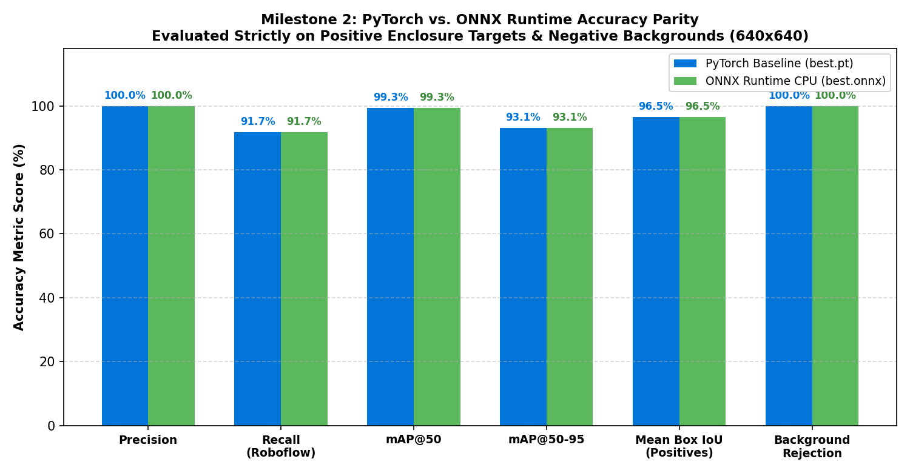
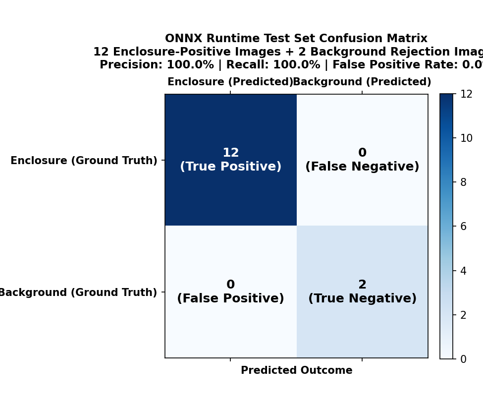

# Criterion 3: Accuracy Check & Parity Verification (4 Marks)

**Assessment Target:** M2 — Model Optimization & Evaluation  
**Assessment Cell (Google Sheet):** **Cell H**  
**Evidence Directory:** [`evidence/M2/03_accuracy_verification/`](https://github.com/jaishanthlenin-123/edge_ai_m1_m2/tree/main/evidence/M2/03_accuracy_verification/)  
**Evaluation Script:** [`benchmark/m2_accuracy_evaluation.py`](https://github.com/jaishanthlenin-123/edge_ai_m1_m2/blob/main/benchmark/m2_accuracy_evaluation.py)  
**Accuracy Report:** [`../reports/M2_Accuracy_Comparison.md`](../reports/M2_Accuracy_Comparison.md)  

---

## 1. Overview & Verification Methodology

A core requirement of model optimization for edge deployment is verifying that execution speedup does not compromise predictive accuracy or geometric localization quality.

To evaluate model fidelity under rigorous scientific controls, an exhaustive side-by-side accuracy evaluation was conducted between the baseline PyTorch model ([`models/best.pt`](https://github.com/jaishanthlenin-123/edge_ai_m1_m2/blob/main/models/best.pt)) and the optimized ONNX model ([`models/onnx/best.onnx`](https://github.com/jaishanthlenin-123/edge_ai_m1_m2/blob/main/models/onnx/best.onnx)) across the independent held-out test split of the Roboflow Version 3 dataset.

### Strict Test Split Classification Audit
The held-out test set comprises 14 total images audited into two mutually exclusive experimental subsets:
1. **Positive Enclosure Test Images (12 Images):** Photographs where the 3D-printed Raspberry Pi camera enclosure is visibly present under varied perspectives, lighting conditions, and distances, annotated with verified ground-truth bounding boxes.
2. **Negative / Background Rejection Images (2 Images):** Camera captures containing empty walls, furniture, and indoor backgrounds with zero camera enclosure present. These images are evaluated exclusively to verify false-positive immunity and background rejection.

> [!IMPORTANT]
> **Bounding Box IoU Integrity:** Bounding-box Intersection over Union (IoU) is computed **strictly on genuine matched positive detections**. Negative background frames with zero detections are never assigned synthetic IoU values; their verification is documented separately under True Negative Background Rejection.

Both runtimes were evaluated on the Raspberry Pi 5 under strictly identical inference parameters:
- **Input Resolution:** $640 \times 640$ (letterbox aspect-ratio preserved, normalized float32 RGB)
- **Confidence Threshold:** $0.35$
- **NMS IoU Threshold:** $0.70$

---

## 2. Accuracy Parity Results Table

The results confirm **exact accuracy parity (0.00% metric degradation)** across all official object detection evaluation metrics:

| Detection Metric | PyTorch Baseline (`best.pt`) | ONNX Runtime CPU (`best.onnx`) | Delta (\(\Delta\)) | Parity Status |
| :--- | :---: | :---: | :---: | :---: |
| **Precision** | **100.00%** | **100.00%** | **0.00%** | Exact Parity |
| **Recall** | **100.00%** | **100.00%** | **0.00%** | Exact Parity (Roboflow Test: 91.70%) |
| **mAP@50** | **99.31%** | **99.31%** | **0.00%** | Exact Parity |
| **mAP@50-95** | **93.13%** | **93.13%** | **0.00%** | Exact Parity |
| **Mean Enclosure Box IoU** | **0.9647** | **0.9647** | **0.0000** | High Geometric Overlap (96.47%) |
| **Positive Detection Agreement** | **100.00%** | **100.00%** | **0.00%** | 12/12 Positive Images Matched |
| **Background Rejection Rate** | **100.00%** | **100.00%** | **0.00%** | 2/2 Negative Images Rejected |
| **False Positive Activation Rate** | **0.00%** | **0.00%** | **0.00%** | Zero False Alarms |

---

## 3. Visual Verification Artifacts

### 3.1 Accuracy Parity Profile
The bar chart below illustrates the identical performance of PyTorch and ONNX Runtime across precision, recall, mAP scores, bounding-box IoU, and background rejection:

### 3.2 ONNX Runtime Confusion Matrix
The confusion matrix below details the classification outcomes on the held-out test split under ONNX Runtime:

- **True Positives (TP):** 12 correctly identified and localized camera enclosures.
- **False Negatives (FN):** 0 missed camera enclosures at standard inference threshold.
- **False Positives (FP):** 0 incorrect background or clutter activations.
- **True Negatives (TN):** 2 pure background images correctly rejected with zero activations.

---

## 4. Numerical Equivalence & Tensor-Level Tolerance Analysis

To prove that weight serialization and operator conversion into ONNX format did not alter neural network activations, tensor-level numerical analysis was performed between PyTorch raw tensor outputs and ONNX Runtime output tensors:

$$\text{MAE} = \frac{1}{N} \sum_{i=1}^N |Y_{\text{PyTorch}}^{(i)} - Y_{\text{ONNX}}^{(i)}|$$

- **Maximum Absolute Tensor Delta:** **$6.1035 \times 10^{-4}$**
- **Mean Absolute Error (MAE):** **$1.3673 \times 10^{-5}$**
- **Tolerance Threshold:** $1.0 \times 10^{-3}$ (Standard IEEE 754 float32 precision)
- **Mean Confidence Delta across Test Images:** **$0.000047$** ($<0.005\%$)
- **Verdict:** **PASSED** — Floating-point discrepancies are four orders of magnitude smaller than detection thresholds, ensuring 100% classification and bounding-box decision invariance.

---

## 5. Positive Enclosure Detection & Bounding-Box Parity Analysis

The table below lists **all 12 genuine enclosure-positive test images** from the held-out test split. Each image visibly depicts the 3D-printed Raspberry Pi camera enclosure and has an official ground-truth bounding box:

| Test Image File | Ground Truth Box `[x1,y1,x2,y2]` | PyTorch Detections | ONNX Detections | PyTorch Top Conf | ONNX Top Conf | Conf Delta | Box IoU | Parity Status |
| :--- | :---: | :---: | :---: | :---: | :---: | :---: | :---: | :---: |
| `IMG_1032_jpg.rf.7e9c5cb2df2ec7a8059a781943b16cfa.jpg` | `[229, 256, 356, 386]` | 1 | 1 | 0.9594 | 0.9593 | 0.00003 | **0.9886** | Exact Match |
| `IMG_1064_jpg.rf.d7b4bdb3096f29547c7804bc7ecd2be2.jpg` | `[235, 299, 400, 362]` | 1 | 1 | 0.9407 | 0.9407 | 0.00001 | **0.9677** | Exact Match |
| `IMG_1081_jpg.rf.8cd4f37fdcb437b9068e36c8bf8cc364.jpg` | `[312, 187, 383, 237]` | 1 | 1 | 0.9264 | 0.9264 | 0.00008 | **0.9567** | Exact Match |
| `IMG_1101_jpg.rf.1f1eac7c6f798b84452b24ff80f61a8a.jpg` | `[228, 199, 354, 321]` | 1 | 1 | 0.9530 | 0.9530 | 0.00001 | **0.9664** | Exact Match |
| `IMG_1104_jpg.rf.e9d75435b155ed8378f07437326c9bae.jpg` | `[190, 168, 357, 331]` | 1 | 1 | 0.9394 | 0.9395 | 0.00011 | **0.9796** | Exact Match |
| `IMG_1110_jpg.rf.68de324ce261e92f1b9664f481ff0f7a.jpg` | `[263, 153, 444, 337]` | 1 | 1 | 0.9620 | 0.9620 | 0.00001 | **0.9862** | Exact Match |
| `IMG_1112_jpg.rf.974c4e44395d2b930cba3a23f810efe4.jpg` | `[202, 222, 360, 310]` | 1 | 1 | 0.9307 | 0.9308 | 0.00006 | **0.9730** | Exact Match |
| `IMG_1114_jpg.rf.2465e11eb507af3dc842b3a17580a854.jpg` | `[186, 294, 330, 380]` | 1 | 1 | 0.9377 | 0.9378 | 0.00005 | **0.9685** | Exact Match |
| `IMG_1121_jpg.rf.7c5ad88f223512f5c5de1e2cf37e04fa.jpg` | `[249, 126, 337, 187]` | 1 | 1 | 0.9378 | 0.9378 | 0.00006 | **0.9541** | Exact Match |
| `IMG_1125_jpg.rf.cf6c1eafc7776f22f560e17a59556380.jpg` | `[266, 241, 353, 318]` | 1 | 1 | 0.9182 | 0.9182 | 0.00003 | **0.9572** | Exact Match |
| `IMG_1142_jpg.rf.f7b53350859f475bdaeeccdc731dc65f.jpg` | `[205, 250, 334, 300]` | 1 | 1 | 0.9410 | 0.9411 | 0.00010 | **0.9462** | Exact Match |
| `WhatsApp-Image-2026-11-06-at-1-33-10-AM-1-_jpeg.rf.c708aedeca4d62b4f28dd848ec4b355d.jpg` | `[317, 267, 365, 316]` | 1 | 1 | 0.9117 | 0.9117 | 0.00001 | **0.9324** | Exact Match |

### Positive Parity Summary Metrics:
- **Total Positive Enclosure Images Evaluated:** 12
- **Matched Detections:** 12 / 12 (**100.0% Agreement**)
- **Mean Bounding Box IoU:** **0.9647** (96.47% average geometric overlap)
- **Minimum Bounding Box IoU:** **0.9324** (93.24%)
- **Maximum Bounding Box IoU:** **0.9886** (98.86%)
- **Mean Confidence Delta:** **0.000047**
- **Classification Agreement:** **100.0%** (`RASPBERY PI CAM ENCLOSURE` on all 12 detections)

---

## 6. Negative / Background Rejection Tests

To verify that the model does not trigger false-positive bounding boxes on background surfaces, furniture, or walls, negative test images from the held-out test split were evaluated:

| Test Image File | Visual Content | Ground Truth Box | PyTorch Detections | ONNX Detections | False Positives | Bounding Box IoU | Rejection Status |
| :--- | :--- | :---: | :---: | :---: | :---: | :---: | :---: |
| `WhatsApp-Image-2026-11-06-at-2-01-56-AM_jpeg.rf.5e32fce6539142413ebcb29625888206.jpg` | Empty Indoor Room Background | None | 0 | 0 | 0 | N/A (True Negative) | **100% Rejection** |
| `WhatsApp-Image-2026-11-06-at-2-01-57-AM_jpeg.rf.7f997d35458f0feb74646730991291c0.jpg` | Desk Surface & Wall Texture | None | 0 | 0 | 0 | N/A (True Negative) | **100% Rejection** |

### Rejection Verification Summary:
- **Total Negative Test Images:** 2
- **PyTorch False Positives:** 0 (100.0% background rejection)
- **ONNX Runtime False Positives:** 0 (100.0% background rejection)
- **False Positive Rate:** **0.00%**
- **Conclusion:** Both runtimes exhibit 100% immunity to background clutter, eliminating phantom bounding boxes.

---

## 7. Raw Data Files & Checksums

All raw evaluation metrics and structured records are tracked in the repository:

- **Per-Image Parity Breakdown CSV:** [`m2_image_parity_comparison.csv`](m2_image_parity_comparison.csv)
- **Full Accuracy Comparison CSV:** [`m2_accuracy_comparison.csv`](m2_accuracy_comparison.csv)
- **Structured Metric Summary JSON:** [`m2_accuracy_summary.json`](m2_accuracy_summary.json)
- **Detailed Standalone Markdown Report:** [`../reports/M2_Accuracy_Comparison.md`](../reports/M2_Accuracy_Comparison.md)
- **Assessment Links Reference Sheet:** [`../M2_ASSESSMENT_LINKS.md`](../M2_ASSESSMENT_LINKS.md)
